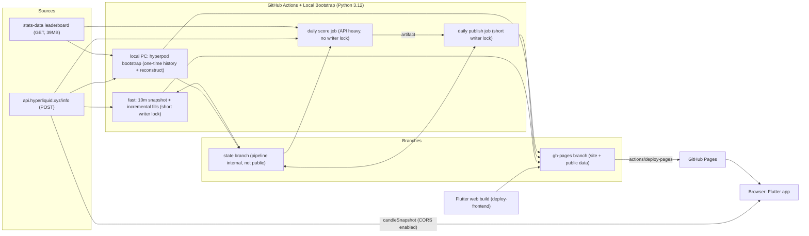

<!--
SPDX-FileCopyrightText: 2026 RyanLin-InfEvo

SPDX-License-Identifier: AGPL-3.0-or-later
-->
<div id="top"></div>

<h1 align="center">HyperPod (<code>hyperpod-analytics</code>)</h1>

<p align="center">
  <strong>Track a curated pod of high-skill Hyperliquid main-perp traders with transparent filtering, point-in-time cohorts, and client-side analytics.</strong>
</p>

> **Disclaimer:** Not financial advice. Data from public Hyperliquid APIs.

---

## Overview & Scope

HyperPod is an open-source (`AGPL-3.0-or-later`), zero-backend-cost analytics system hosted on GitHub Actions and GitHub Pages (`RyanLin-InfEvo/hyperpod-analytics`). It discovers, filters, scores, and tracks top traders on Hyperliquid's **main perp DEX** (excluding HIP-3 builder DEXes, spot markets, and vaults) and serves pre-compressed columnar datasets to a Flutter Web frontend.

### Tracked Universe
- **Markets:** Main perp DEX only.
- **Coins:**
  - **Pinned:** `BTC`, `ETH`, `SOL`, `HYPE` (always tracked).
  - **Dynamic:** Top 20 non-pinned main-perp coins ranked by aggregate whitelist notional open interest, with 30-day exit stickiness (`coins.stickyDays: 30`) and a hard cap of `coins.maxTracked: 32`.
- **Subaccounts & Vaults:** Vaults are excluded; subaccounts use `merge_after_filter` by default (evaluated independently in Stage 2, then merged in the frontend by `master ?? address`).

### Core Architectural Invariants
1. **Pipeline vs. Frontend Separation:** The Python pipeline collects, normalizes, scores, and exports per-address data; all weighting (`equal`, `accountValue`, `positionValue`), dust filtering, and chart aggregations run client-side in pure Dart (`app/lib/domain/`).
2. **`Unknown != 0`:** Positions outside a snapshot file's `tracked` intervals or before an address's `coverageStart` are explicitly excluded and never coerced to `0`.
3. **Single-Commit Orphan Branches:** Both `state` (internal pipeline state) and `gh-pages` (public static site + `data/`) maintain a single commit via `git commit --amend` and `git push --force-with-lease`.
4. **Permanent Public Archive (`gh-pages/data/`):** Snapshots, aggregated whitelist fills, and `5m` candles are never auto-deleted. Data older than 7 UTC days is compacted into `.json.gz` monthly files and verified via schema validation + position-replay equivalence before replacing daily files.
5. **No Raw Candidate Fills Persisted:** Candidate pools only persist reconstructed round-trip trades and daily summary stats in `state/daily/`. Only aggregated fills for whitelisted addresses are published to `gh-pages/data/fills/`.
6. **Writer-Lock & Cursor Isolation:** Long-running API collection (`daily score`) and web builds (`deploy-frontend build`) never hold `concurrency: hyperpod-writer`. `fast` owns `state/fast/` (`fillsCursorPublish`) and `daily` owns `state/daily/` (`fillsCursorScoring`, `publish_fill_cursors.json`).

---

## System Architecture



---

## Repository Structure

```text
hyperpod-analytics/
├── README.md                     # Project overview, architecture, setup & disclaimers
├── LICENSE                       # AGPL-3.0-or-later
├── AGENTS.md                     # Agent engineering guardrails
├── shell.nix                     # Deterministic Nix dev environment (Python 3.12, uv, ruff, Flutter, check-jsonschema)
├── .fvmrc                        # Pinned Flutter version
├── docs/
│   ├── implementation_plan.md    # Authoritative system specification
│   ├── status.md                 # Cross-session handoff state
│   ├── adr/                      # Architecture Decision Records
│   ├── proposals/                # Specification amendment proposals
│   ├── research/                 # Phase 0 empirical API probes
│   └── phase-reports/            # Phase gate reports
├── schemas/                      # JSON Schema (draft 2020-12) single source of truth + valid/invalid examples
├── fixtures/
│   ├── api/                      # Recorded live Hyperliquid API fixtures
│   └── site-data/                # Small synthetic site-data dataset for contract & frontend tests
├── config/
│   ├── pipeline.yaml             # Single-source pipeline thresholds, weights & rate limits
│   ├── seed_addresses.txt        # Manual candidate seed addresses
│   └── blocklist.txt             # Manual excluded addresses
├── pipeline/                     # Python 3.12 package (uv, pydantic, typer, ruff, mypy --strict, pytest, hypothesis)
├── app/                          # Flutter Web frontend (Riverpod, pure-Dart domain/, bundled test fonts)
├── scripts/                      # Schema validation and fixture utilities
└── .github/workflows/            # CI, pipeline-fast, pipeline-daily, pipeline-backfill, deploy-frontend
```

---

## Local Development

HyperPod uses a Nix shell (`shell.nix`) to pin Python `3.12`, `uv`, `ruff`, `check-jsonschema`, and `flutter` (`3.41.9`, matching `.fvmrc`).

```bash
# Enter Nix development shell (or prefix commands with `nix-shell --run "..."`)
nix-shell

# Validate JSON Schemas, valid/invalid examples, and fixtures/site-data/
bash scripts/validate_schemas.sh

# Run Python pipeline lint, type-check, and tests
cd pipeline
uv sync --locked
uv run ruff check .
uv run ruff format --check .
uv run mypy --strict src tests
uv run pytest

# Run Flutter static analysis, unit/widget tests, and web build
cd ../app
flutter pub get
flutter analyze
flutter test
flutter build web --release --base-href /hyperpod-analytics/
```

---

## Bootstrap & Deployment Guide (Overview)

Detailed workflow execution is implemented across Phases 2–4 (`docs/implementation_plan.md` `§6.2`, `§6.5`, `§13`):

1. **GitHub Repository Settings:**
   - Enable `Read and write permissions` under `Settings → Actions → General → Workflow permissions`.
   - Set `Settings → Pages → Build and deployment → Source` to **GitHub Actions**.
2. **One-Time Local Bootstrap (Phase 4):**
   - Run `hyperpod bootstrap` locally (supports `--budget-minutes` checkpointing) to backfill historical fills (`<= 10,000` per candidate), tiered candles, and reconstructed pre-launch snapshots, then publish initial `state` and `gh-pages` branches before enabling scheduled GitHub Actions workflows.
3. **Ongoing Automation:**
   - `pipeline-fast.yml` (`*/10 * * * *`): collects 10-minute snapshots and incremental whitelist fills.
   - `pipeline-daily.yml` (`17 0 * * *`): runs lock-free `discover` / `score` / `candles` followed by a short-locked `publish` job (and monthly `.json.gz` compaction).
   - `deploy-frontend.yml`: builds and publishes the Flutter Web app to `gh-pages` while preserving `data/`.

---

## License

Licensed under the **GNU Affero General Public License v3.0 or later** (`AGPL-3.0-or-later`). See [LICENSE](LICENSE) for full terms.
