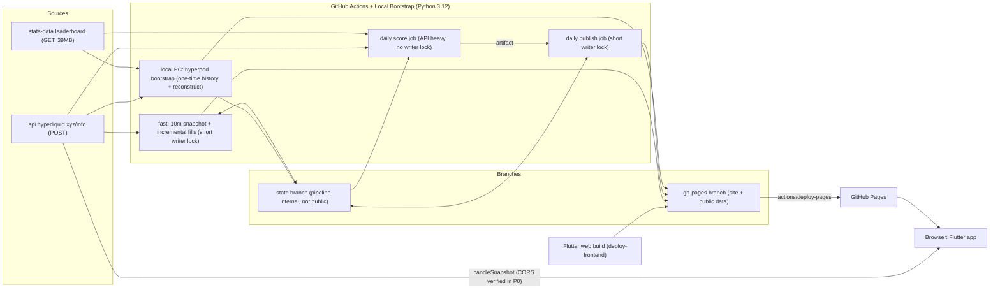
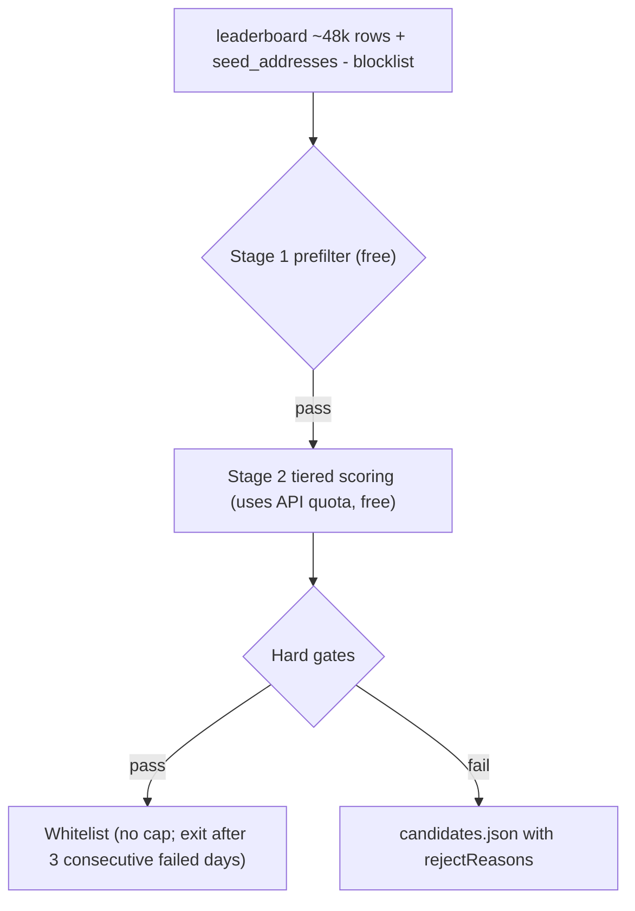
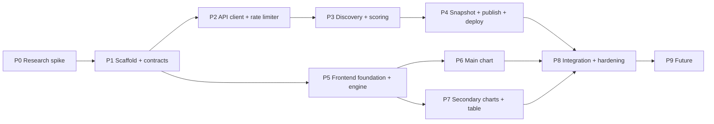

<!--
SPDX-FileCopyrightText: 2026 RyanLin-InfEvo

SPDX-License-Identifier: AGPL-3.0-or-later
-->
# HyperPod (`hyperpod-analytics`) 實作計劃書

> 本文件給執行開發的 AI agent 使用。每個階段都有**任務、產出檔案、驗收條件**。
> - 標示 **【規範】** 的公式與資料定義不得自行更改；誰可以改什麼，見 §11.2 授權矩陣。
> - 一定要由使用者完成的步驟集中列在 §13；agent 不得繞過。
> - 跨 session 的進度記錄在 `docs/status.md`（§11.4）；每次開始工作先讀它，再讀本文件。

**修訂紀錄**
- **v2（2026-11-15）**：依審查修正——daily 拆成「無鎖評分 + 短鎖發佈」（§6.2）；分離評分與發佈兩個成交游標、分頁含邊界去重（§4、§5.2）；重建區間的回溯入選與「未知倉位」語意（§3.2、§3.3、§6.5、§7.1）；月檔改 gzip 儲存並重估容量（§3、§3.8）；追蹤幣種變動規則（§3.1.1）；子帳戶合併納入【規範】（§7.1）；#5 各權重模式的精確公式（§7.4）；`fundingShare` 改用 `userFunding`（§5.4）；評分頻率分層（§5.1）；授權矩陣、Phase 審核流程、停止條件（§11）；使用者步驟清單（§13）；驗收條件改為可自動判定。
- v1：初版。

---

## 1. 系統總覽



**原則**
1. Pipeline 只負責「收集 + 清洗 + 評分 + 輸出逐地址原始資料」；所有**權重化與聚合**在前端計算（權重模式與 dust 門檻由使用者即時調整）。
2. 唯一例外：白名單評分（運算量大、與 UI 參數無關）在 pipeline 完成。
3. 兩個 orphan 分支都採「**單一 commit + force push**」，Git 歷史不增長；**所有歷史資料永久保存在檔案內**（按月歸檔為 gzip，絕不自動刪除）。
4. 首次全量回補在**使用者本機**透過免費官方 Info API 一次跑完（由 agent 以背景程序執行，含用歷史成交＋淨值曲線重建上線前快照），上傳後 GitHub Actions 只跑增量。
5. 前後端以 `schemas/` 下的 JSON Schema 為唯一契約，雙方都有契約測試。
6. **寫入鎖只在發佈時持有**：任何大量呼叫 API 的步驟都不得持有寫入鎖（§6.2）。
7. **「未知」不等於「0」**：倉位無法得知的時段一律明確標示為未知（§3.3），絕不以 0 代替。

**專案範圍與設定**
- **授權與 Repo**：`AGPL-3.0-or-later`（Phase 1.1 以 AGPL 全文取代 repo 現有的 Apache-2.0 `LICENSE`）；公開 repository `RyanLin-InfEvo/hyperpod-analytics`。
- **前端語言**：v1 採英文 UI，架構預留 i18n（繁體中文列為 Phase 9）。
- **市場與幣種範圍**：只追蹤主 perp dex（排除 HIP-3 與現貨）；固定幣種 `BTC / ETH / SOL / HYPE`（pinned），加上動態幣種：白名單持倉名目總額前 20 名（進出規則見 §3.1.1）。
- **白名單與排程**：條件制、不設名額上限（連續 3 日未通過才退出）；Fast loop 每 10 分鐘執行。
- **保留與 K 線**：所有快照、白名單成交、`5m` K 線**永久保留、永不刪除**（超過 7 天合併為 gzip 月檔；`data/` 超過 800 MB 時只發警告）。
- **子帳戶與 Vault**：vault 一律排除；子帳戶預設 `merge_after_filter`（各自獨立篩選，通過者在前端按主帳戶合併為一個實體，§5.6、§7.1）；Phase 0.8 實測後可依 §11.2 調整預設值。

---

## 2. Repository 結構

```
hyperpod-analytics/
├── README.md                     # 專案說明、免責聲明、架構圖、部署與 bootstrap 指南
├── LICENSE                       # AGPL-3.0-or-later
├── AGENTS.md                     # 給 agent 的工作守則（見 §11）
├── .fvmrc                        # 鎖定 Flutter 版本（CI 與 golden test 共用）
├── docs/
│   ├── implementation_plan.md    # 本文件
│   ├── status.md                 # 跨 session 進度、等待中的事項（§11.4）
│   ├── metrics.md                # 所有指標公式（從 §5、§7 抽出，給使用者看）
│   ├── research/                 # Phase 0 的實測紀錄
│   ├── adr/                      # 架構決策紀錄 0001-*.md
│   ├── proposals/                # 需使用者核准的規範修訂提案（§11.2）
│   └── phase-reports/            # 每個 Phase 的結案報告（§11.3）
├── schemas/                      # JSON Schema（draft 2020-12）
│   ├── manifest.schema.json
│   ├── whitelist.schema.json
│   ├── snapshot.schema.json
│   ├── fills.schema.json
│   ├── candidates.schema.json
│   ├── criteria.schema.json
│   └── candles.schema.json
├── fixtures/                     # 真實 API 回應錄製檔（皆公開資料，不需去敏）
│   ├── api/                      # clearinghouseState_*.json, userFillsByTime_*.json ...
│   └── site-data/                # 一份完整的小型 data/ 目錄，給前端測試用
├── config/
│   ├── pipeline.yaml             # 所有門檻與參數（§5、§6）
│   ├── seed_addresses.txt        # 手動加入候選
│   └── blocklist.txt             # 手動排除
├── pipeline/                     # Python
│   ├── pyproject.toml            # uv 管理；ruff、mypy strict、pytest、hypothesis
│   ├── src/hyperpod/
│   │   ├── cli.py                # typer：discover / score / backfill / snapshot / candles / reconstruct /
│   │   │                         #        bootstrap / publish / health / verify-live / debug-address
│   │   ├── config.py             # 讀 pipeline.yaml → pydantic Settings
│   │   ├── client/
│   │   │   ├── ratelimit.py      # token bucket（weight-aware）
│   │   │   ├── info_api.py       # 所有 info 端點的型別化包裝（含 §5.2 分頁規則）
│   │   │   └── leaderboard.py
│   │   ├── models/               # pydantic：API 回應模型 + 輸出模型
│   │   ├── discovery/prefilter.py
│   │   ├── scoring/
│   │   │   ├── trades.py         # fills → round trips
│   │   │   ├── metrics.py        # PF、勝率、MDD、持倉時間、maker 比例、funding…
│   │   │   ├── filters.py        # 各項排除規則
│   │   │   └── whitelist.py      # 條件制白名單 + 退出緩衝 + membership + 追蹤幣種
│   │   ├── snapshot/
│   │   │   ├── collect.py        # 10 分鐘即時快照
│   │   │   ├── reconstruct.py    # 用 fills + portfolio + K 線重建上線前歷史快照
│   │   │   └── candles.py        # 5m K 線歸檔、4h 總覽、新幣種回補
│   │   ├── storage/
│   │   │   ├── state_store.py    # state 分支讀寫（依擁有者分區，§4）
│   │   │   ├── site_writer.py    # gh-pages data/ 輸出、月檔合併、manifest 重建
│   │   │   ├── git_publish.py    # fetch → 寫入自有路徑 → 單一 commit → force-with-lease（含重試）
│   │   │   └── formats.py        # 欄式格式、量化、gzip
│   │   ├── ops/health.py         # 依 runs/*.jsonl 與快照間隔判定健康度（§9 Phase 4 驗收）
│   │   └── util/time.py
│   └── tests/
│       └── reference/frontend_math.py   # §7 的 Python 參考實作，輸出 golden JSON
├── app/                          # Flutter
│   ├── pubspec.yaml              # environment.flutter 鎖定版本（CI 依此安裝）
│   ├── lib/
│   │   ├── main.dart
│   │   ├── app/                  # MaterialApp、theme、routing（Flutter Web 預設 hash 路由）
│   │   ├── data/
│   │   │   ├── models/           # 對應 schemas 的 Dart 模型
│   │   │   ├── sources/          # SiteDataSource（GitHub Pages，含 gzip 解壓）、CandleSource（HL API）
│   │   │   └── repositories/
│   │   ├── domain/               # 純 Dart，不 import flutter（可單元測試、可在 VM 跑 benchmark）
│   │   │   ├── entities.dart     # 子帳戶合併、tracked 區間、cohort（§7.1）
│   │   │   ├── weighting.dart
│   │   │   ├── filters.dart      # dust filter
│   │   │   ├── consensus.dart
│   │   │   ├── long_short.dart
│   │   │   ├── entry_average.dart
│   │   │   ├── exposure_delta.dart
│   │   │   ├── fill_markers.dart
│   │   │   ├── frvp.dart
│   │   │   └── histogram.dart
│   │   ├── state/                # Riverpod providers
│   │   └── ui/
│   │       ├── shell/            # 版面、header、資料新鮮度 badge
│   │       ├── controls/         # 幣種、權重、dust 滑桿、時間範圍、cohort 切換
│   │       ├── main_chart/       # CustomPainter 圖層
│   │       ├── charts/           # fl_chart 統計圖
│   │       └── whales/           # 地址表格與詳情
│   ├── test/
│   │   └── fonts/                # golden test 用的固定字型
│   └── benchmark/                # domain 計算效能基準（CI 執行，§7.7）
└── .github/workflows/
    ├── ci.yml
    ├── pipeline-fast.yml
    ├── pipeline-daily.yml        # job score（無寫入鎖）→ job publish（寫入鎖）
    ├── pipeline-backfill.yml
    └── deploy-frontend.yml
```

---

## 3. 資料契約（gh-pages 分支的 `data/` 目錄）

- 所有時間戳為 **UTC epoch 毫秒**；所有金額為 USD。
- `schemaVersion` 為整數。**新增可選欄位不升版**；刪除、改名或改變既有欄位語意屬破壞性變更，須升版並經使用者核准（§11.2）。前端遇到不支援的版本要顯示錯誤，不可崩潰。
- **檔案格式**：`manifest.json`、`whitelist.json`、`criteria.json`、`candidates.json`、`snapshots/latest.json`、所有 `days/` 日檔為純 JSON；所有月檔、`5m` K 線月檔、`overview_4h`、`backfill_15m_1h` 為 **gzip 壓縮的 JSON（`.json.gz`）**。理由：GitHub Pages 的 1 GB 上限以磁碟檔案大小計算，數值陣列預壓縮後約小 4–6 倍。Pages 會以 `application/gzip` 原樣傳送（不加 `Content-Encoding`），前端自行解壓（§8.5）。

```
data/
├── manifest.json
├── whitelist.json
├── criteria.json                  # 目前與歷史的篩選條件（前端唯讀顯示）
├── candidates.json
├── snapshots/
│   ├── latest.json
│   ├── days/2026-11-14.json        # 最近 7 天日檔（全解析度）
│   └── months/2026-10.json.gz      # 超過 7 天合併為月檔（永久保留，見 §3.3）
├── fills/BTC/
│   ├── days/2026-11-14.json        # 最近 7 天白名單成交日檔
│   └── months/2026-10.json.gz      # 超過 7 天合併為月檔（永久保留，見 §3.4）
└── candles/BTC/
    ├── overview_4h.json.gz         # 全歷史 4h K 線（長天期總覽與 1D 聚合用，單檔）
    ├── backfill_15m_1h.json.gz     # 該幣種開始追蹤時官方還拿得到的 15m（第 18–52 天）與 1h（第 53–208 天）
    └── 5m/2026-11.json.gz          # 5m K 線月檔（永久保留，前端聚合 15m/1h/4h/1D）
```

### 3.1 `manifest.json`
```json
{
  "schemaVersion": 1,
  "generatedAt": 1763127600000,
  "latestSnapshotAt": 1763127540000,
  "launchedAt": 1763000000000,
  "whitelistVersion": "2026-11-14",
  "criteriaVersion": 3,
  "coins": [
    {"coin": "BTC", "pinned": true,  "trackedFrom": 1747000000000, "trackedTo": null},
    {"coin": "WIF", "pinned": false, "trackedFrom": 1762992000000, "trackedTo": null}
  ],
  "files": {
    "snapshotDays": ["2026-11-08", "...", "2026-11-14"],
    "snapshotMonths": ["2026-08", "2026-09", "2026-10", "2026-11"],
    "fills": {
      "BTC": {
        "days": ["2026-11-08", "...", "2026-11-14"],
        "months": ["2026-08", "2026-09", "2026-10", "2026-11"]
      }
    },
    "candles": {
      "BTC": {"months5m": ["2026-10", "2026-11"], "hasBackfill": true, "hasOverview4h": true}
    }
  },
  "storage": {"totalBytesOnDisk": 48200000, "softLimitBytes": 800000000},
  "pipeline": {"fastLastOk": 1763127540000, "dailyLastOk": 1763078400000, "warnings": []}
}
```
- `launchedAt`：第一筆即時快照的時間；在此之前的快照都是重建資料（§6.5）。
- `coins`：追蹤區間列表；同一幣種可以有多段（停止追蹤後又重新入榜）。
- `files` 陣列只存鍵值：`days` 存 `"YYYY-MM-DD"`（對應 `.json`），`months` 與 `months5m` 存 `"YYYY-MM"`（對應 `.json.gz`）。
- `storage.totalBytesOnDisk`：統計 `gh-pages` 上 `data/` 目錄所有檔案（含 `.json.gz`）的實際磁碟位元組總和。
- manifest 是**衍生檔**：每次發佈都由 `site_writer` 依當下 `data/` 目錄內容重新產生，不做合併。

#### 3.1.1 追蹤幣種規則
- pinned 幣種永遠追蹤。
- 動態幣種：daily publish 依當日白名單在主 perp dex 的持倉名目總額排名，前 20 名（不含 pinned）列入。
- **生效時點**：變更從下一個 UTC 日 00:00 起生效；日檔內的 `coins` 一整天固定。
- **黏性**：動態幣種跌出前 20 名後仍持續追蹤 `coins.stickyDays`（預設 30）天，期滿仍未回到前 20 名才停止並寫入 `trackedTo`；已歸檔檔案永久保留。
- **上限**：同時追蹤的幣種數上限為 `coins.maxTracked`（預設 32，含黏性期中的幣種）；超過時淘汰名目排名最低者。
- **新幣種加入時**，daily 把回補工作排入佇列（可分多日完成）：K 線依 §3.5 深度回補；白名單地址在該幣種的歷史成交以 `userFillsByTime` 回補（受 10k 上限）；快照只從 `trackedFrom` 起記錄，不重建該幣種的歷史快照。

### 3.2 `whitelist.json`
```json
{
  "schemaVersion": 1,
  "version": "2026-11-14",
  "addresses": [
    {
      "id": 0,
      "address": "0xabc...",
      "label": null,
      "master": null,
      "subAccounts": ["0xdef..."],
      "coverageStart": 1745000000000,
      "score": 0.83,
      "metrics": {
        "accountValue": 12500000, "equitySource": "perp|perp+spot",
        "pnlAllTime": 4200000, "roiAllTime": 0.61, "pnlMonth": 310000,
        "maxDrawdown": 0.22, "profitFactor": 2.4, "profitFactorRobust": 1.9,
        "winRate": 0.58, "nTrades": 143, "historyDays": 212,
        "fillsPerDay": 31, "medianHoldMinutes": 540, "makerRatio": 0.34,
        "turnoverMonth": 6.1, "fundingShare": 0.04
      },
      "membership": [[1747000000000, 1763000000000, 0], [1763000000000, null, 3]]
    }
  ]
}
```
- `id`：整數索引，快照與成交檔用它代替地址以節省空間；**id 永不重用**（退出白名單的地址保留 id）。
- `master`：若此地址是子帳戶，為其主帳戶地址；否則 `null`。主帳戶本身不一定在白名單中。前端以 `master ?? address` 作為實體鍵（§7.1）。
- `subAccounts`：此地址的子帳戶清單（僅供顯示）。
- `coverageStart`：此地址倉位可以確定的最早時間（= 已取得的最早一筆 fill 時間）。即時追蹤開始後的資料不受此限。
- `membership`：入選區間列表 `[enterTs, exitTs|null, criteriaVersion]`，供 point-in-time cohort 使用。**`criteriaVersion = 0` 保留給「回溯入選」**：bootstrap 時入選的地址，其回溯區間 `[max(coverageStart, reconstructStart), launchedAt)` 記為版本 0，表示「用上線時的條件事後選出」（含前瞻偏差，UI 須標示，§7.1）。
- `addresses` 包含**歷史上曾入選**的所有地址（已退出者的最後一段 membership 有 exitTs）。
- `tier`（可選，Proposal 0003 Stage A，Phase 5 加入，不升 `schemaVersion`）：依帳戶淨值劃分之資金量體分級 `"leviathan"`（`$50M+`）／`"super_whale"`（`$1M–$50M`）／`"whale"`（`$500K–$1M`）／`"small_whale"`（`$100K–$500K`）／`"sniper"`（`$50K–$100K`）；v1 先涵蓋前兩級。
- `sources`（可選，Proposal 0003 Stage A，Phase 5 加入，不升 `schemaVersion`）：地址來源標籤陣列（v1 為 `["leaderboard"]`、`["seed"]`、`["subAccount"]`；Phase 9.1 擴充 `["source:<name>"]`、`["coinglass_api"]`）。

### 3.3 快照：關鍵影格 + 變更紀錄（keyframe + change-log）
**設計理由**：10 分鐘內絕大多數倉位不會變。若每筆快照都完整存一次，實測（200 地址 × 3 倉位、每天 144 筆）**原始 JSON 2.1 MB/天**；gzip 後只有 38 KB，但瀏覽器解壓後仍要**解析 2.1 MB**、建立數十萬個物件，這才是效能瓶頸。改成「只記錄變化」後原始大小降到 **85 KB/天（約 25 倍）**。

檔案：`snapshots/days/YYYY-MM-DD.json`（每天一檔，UTC 切日）
```json
{
  "schemaVersion": 1,
  "coins": ["BTC", "ETH"],
  "reconstructed": false,
  "tracked": [[0, 1763078400000, null], [1, 1763078400000, 1763085600000]],
  "keyframe": {"t": 1763078400000, "pos": [[0, 0, 12.5, 95210.0], [1, 0, -3.1, 98800.0]]},
  "posChanges": [[1763079000000, 1, 0, -4.2, 98650.0], [1763080200000, 0, 0, 0, null]],
  "series": {
    "t":    [1763078400000, 1763079000000],
    "mark": [[97123.5, 97180.0], [3120.2, 3121.0]],
    "av":   {"addrIds": [0, 1], "values": [[12500000, 12510000], [3300000, null]]}
  },
  "stale": [[1763079000000, [1]]]
}
```
- `coins`：本檔的幣種清單，當日固定（§3.1.1）；`coinIdx` 指向本檔的 `coins`。
- `tracked`：`[addrId, fromTs, toTs|null]`，本檔時間範圍內該地址倉位**已知**的區間（即時追蹤中，或重建資料中 ≥ `coverageStart`）。**區間外倉位為未知，前端不得當作 0。** 地址退出白名單後停止輪詢，區間在退出時刻結束；一個地址可以有多段區間。
- `keyframe`：檔案起點時刻、所有在追蹤區間內的地址的完整倉位 `[addrId, coinIdx, szi, entryPx]`（只列 `szi ≠ 0`）。地址在檔案中途開始追蹤時，以 `posChanges` 寫入它的初始倉位（每個非零幣種一筆）。
- `posChanges`：之後**有變化時才記錄** `[t, addrId, coinIdx, szi, entryPx]`；`szi = 0` 代表平倉（`entryPx` 為 `null`）。任一時點的倉位 = keyframe + 依序套用 ≤ t 的變更，且只在 `tracked` 區間內有效。
- `entryPx` 可為 `null`：重建資料中，倉位在第一次歸零之前無法得知成本。
- `reconstructed`（可選，預設 false）：區分「即時採集快照」與「上線前由成交與淨值曲線推算的歷史快照」；月檔若同時含兩者，以 `reconstructedBefore` 標記分界時間戳，並以 `markResolution`（`"1h"`／`"4h"`）註明重建期間 mark 的來源解析度（§6.5）。
- `series`：每次快照都會變的數值以**欄式陣列**儲存（`mark[coinIdx][k]`、`av.values[addrIdx][k]` 對應 `t[k]`）。地址未追蹤或該次取得失敗時，值為 `null`。
- `stale`：`[t, [addrIds]]`，該時點沿用上一筆資料的地址（§6.4）；省略代表沒有。
- **數值量化**：accountValue 取 4 位有效數字、價格取 6 位有效數字、szi 取該幣種 `szDecimals`；量化誤差對權重的影響 < 0.1%。
- **positionValue 不存**，前端以 `|szi| × mark` 計算（確保同一時點價格一致）。
- **永久保留與月檔合併（絕不刪除歷史）**：
  - 最近 **7 個 UTC 日**保留為 `snapshots/days/YYYY-MM-DD.json`（10 分鐘全解析度）。
  - 超過 7 天的日期由 daily publish 合併：`series` 稀疏化為每小時最後一點（`posChanges`、`tracked`、`stale` 全解析度保留），併入 `snapshots/months/YYYY-MM.json.gz`（同結構；月檔的 `keyframe` 是該月最早時刻的完整倉位；`coins` 與 `series.av.addrIds` 取該月聯集並重映射索引，未追蹤時段對應的 `mark` 與 `av` 填 `null`）。
  - **搬移規則**：月檔寫入後必須通過 schema 驗證與內容比對（以該日每個 `posChanges` 時點重播，倉位完全相同），才可刪除對應日檔。這是唯一允許的刪除，性質為搬移，不是刪除歷史。
  - **互斥原則**：任一 UTC 日只存在於 `days/` 或 `months/` 其一，不可重複也不可遺漏（當月較舊的日期在 `months/2026-11.json.gz`，近 7 天在 `days/`）。
  - **永不自動刪除舊月份**；若 `data/` 磁碟總容量超過 **800 MB**（接近 GitHub Pages 1 GB 限制），僅在 `manifest.pipeline.warnings` 與 UI 發出警告，提示維護者處理冷資料。
- `snapshots/latest.json`：最新一筆的完整倉位 + mark + av + tracked 地址（給首屏用，< 30 KB）。

### 3.4 成交 `fills/{coin}/days/{date}.json` 與 `months/{YYYY-MM}.json.gz`
```json
{
  "schemaVersion": 1, "coin": "BTC",
  "fills": [[1763120000000, 0, "OL", 96500.0, 1.2, 115800.0, 0]]
}
```
- 欄位：`[time, addrId, dirCode, px, sz, notional, liq]`（7 欄固定寬度，`liq ∈ {0, 1}`，便於轉成 typed arrays）；`dirCode ∈ {OL, CL, OS, CS}`；翻倉已拆成兩筆（§5.2）。
- **彙總**：每一列是同一 `(time, addrId, dirCode, liq)` 的原始 fills 彙總（`px` = VWAP，`sz`、`notional` 加總）；此鍵在檔內唯一。
- **寫入一律 upsert by key**：因為成交以「含邊界」方式重抓（§5.2），同一毫秒的彙總列每次都是完整重算，直接覆蓋即可，不會重複也不會遺漏。
- **永久保留與分檔**：最近 7 天存 `days/YYYY-MM-DD.json`，超過 7 天依 §3.3 的搬移規則併入 `months/YYYY-MM.json.gz`（按 `time` 遞增排序、鍵唯一）。所有歷史成交**永久保留**。
- **首次回補與補齊**：本機 `bootstrap`、新入選地址、新加入追蹤的幣種，都會把已抓到的主 perp dex 歷史成交（受官方最近 10,000 筆上限）依月份 upsert 進 `months/` 或 `days/`。

### 3.5 K 線永久歸檔 `candles/{coin}/`
官方 `candleSnapshot` 最多只提供「從現在往前 5,000 根」（`5m` 約 17 天、`15m` 約 52 天、`1h` 約 208 天）。為確保日後回看時仍有細顆粒度 K 線，由 pipeline 主動歸檔：
```json
{
  "schemaVersion": 1, "coin": "BTC", "interval": "5m",
  "c": [[1763120100000, 96500.0, 96620.0, 96480.0, 96590.0, 142.3]]
}
```
- `candles/{coin}/5m/YYYY-MM.json.gz`：daily 每次抓取「上次已歸檔的最後一根」到「昨日結束」之間的 `5m` K 線，依 `t` upsert（因此 daily 漏跑時，17 天內會自動補回）。**永久保留**；前端切換 `15m / 1h / 4h / 1D` 時直接由 `5m` 聚合。
- `candles/{coin}/backfill_15m_1h.json.gz`：該幣種**開始追蹤時**（bootstrap 或新幣種加入）一次性抓取官方還拿得到的細 K 線（第 18–52 天 `15m`、第 53–208 天 `1h`）。
- `candles/{coin}/overview_4h.json.gz`：全歷史 `4h` K 線（單檔，同時提供 `1D` 聚合），daily 以 upsert 方式追加。使用者點 `1Y` / `ALL` 時**只載入這 1 個檔案**；只有切回細週期檢視特定時段時才按月載入 `5m/`。

### 3.6 `criteria.json`（篩選條件，前端唯讀）
前端**不能修改**篩選條件，但必須能完整顯示「目前用什麼條件選出這批地址」。Pipeline 每次 daily 執行時從 `config/pipeline.yaml` 匯出：
```json
{
  "schemaVersion": 1,
  "current": {
    "version": 3,
    "effectiveFrom": 1763078400000,
    "hash": "sha256:9f2c…",
    "stage1": [
      {"key": "minAccountValue", "label": "Min account value", "op": ">=", "value": 1000000, "unit": "USD",
       "description": "Account equity from leaderboard"}
    ],
    "gates": [
      {"key": "mdd", "label": "Max drawdown", "op": "<=", "value": 0.45, "unit": "ratio",
       "description": "Peak-to-trough of perp all-time PnL relative to account value at peak"},
      {"key": "hft.fillsPerDay", "label": "Fills per day", "op": "<=", "value": 500, "unit": "count", "description": "..."}
    ],
    "membership": {"exitAfterFailedDays": 3, "subaccounts": "merge_after_filter", "excludeVaults": true},
    "scope": {"perpDex": "main", "spot": false, "hip3": false},
    "stats": {"candidates": 2391, "passed": 184, "rejectedBy": {"hft": 812, "mdd": 403, "pf": 377}}
  },
  "history": [
    {"version": 2, "effectiveFrom": 1762473600000, "effectiveTo": 1763078400000, "hash": "sha256:…", "changes": [
      {"key": "pf", "from": 1.3, "to": 1.5}]}
  ]
}
```
規則：
- `label` / `description` 寫在 `config/pipeline.yaml` 每個參數旁（單一來源），pipeline 原樣匯出；新增門檻時**必須**同時補 label 與 description，否則 CI 失敗。
- 條件內容的 hash 改變 → `version + 1`，舊版本移入 `history`，並自動計算 `changes`（逐鍵差異）。版本號從 1 起算；**0 保留給回溯入選**（§3.2）。
- `stats.rejectedBy`：每個條件淘汰的人數（一個地址可能被多個條件淘汰，分別計數）。
- `whitelist.json` 每段 `membership` 附上入選當時的 `criteriaVersion`，讓歷史圖表能說明「這段期間用的是第幾版條件」。

### 3.7 `candidates.json`（給圖 #1 校準用）
預篩後、深度門檻前的候選池統計：每個候選的 `fillsPerDay`、`makerRatio`、`medianHoldMinutes`、`maxDrawdown`、`profitFactorRobust`、`turnoverMonth`，以及通過/淘汰原因 `rejectReasons: ["hft","mdd",...]`。不含地址字串（只用匿名索引），以縮小檔案。

### 3.8 檔案大小與效能預算
**結論：資料量本身不大，問題在「瀏覽器解析」與「HTTP 請求數」，而不是「儲存格式是 JSON」。** 單次瀏覽只載入目前可視區間與單一幣種的檔案。

估算假設：白名單 200 地址、同時追蹤約 28 個幣種、彙總後成交約 30 列/地址/天（已依 Phase 0.12 實測更新：見 `docs/research/storage-sizing.md`）。

| 項目 | 原始大小 | 磁碟大小（月檔 gzip） |
|---|---|---|
| 一天快照（§3.3 格式，144 點 + 1,200 posChanges） | ~389 KB（389,371 B） | 日檔為純 JSON，7 天合計 ≈ 2.73 MB（CDN gzip 傳輸 ~227 KB） |
| 一年快照（12 個月檔，series 每小時一點，36k posChanges/月） | ~34.7 MB（單月 ~2.90 MB） | ~3.28 MB（單月 ~274 KB，壓縮 10.58×） |
| 一年全幣種成交（28 幣種分檔，約 2.16M 列） | ~99.5 MB（BTC 單月 ~1.24 MB） | ~25.5 MB（BTC 單月 ~326 KB，單月合併解析 125.9 ms > 100 ms 故分檔） |
| bootstrap 一次性成交回補（200 地址 × ≤10k 筆，中位聚合比 1.25× → ~1.6M 列） | ~73.7 MB | ~18.9 MB |
| 一年 `5m` K 線（28 幣種 × 12 月，單幣種單月 8,640 根 ~494 KB） | ~165.9 MB | ~50.1 MB（單幣種單月 ~149 KB；另 `backfill_15m_1h` 一次性 ~5.9 MB） |
| `overview_4h`（28 幣種 × 2,190 根/年） | ~131 KB／幣種／年（28 幣種 ~3.68 MB） | ~46.6 KB／幣種／年（28 幣種 ~1.31 MB） |
| 首屏載入 `manifest + whitelist + criteria + latest + 近 7 天日檔（快照 + BTC 成交 + 當月 BTC 5m K 線）` | — | **實測傳輸量 ~0.5 MB（< 1.5 MB 預算）** |

> 依 Phase 0.12 實測，第一年磁碟用量約 ~110 MB（含 bootstrap 成交回補 ~18.9 MB、`backfill_15m_1h` ~5.9 MB、熱資料 ~4.6 MB 與中繼檔 < 0.3 MB），之後每年約 ~85 MB/年（未觸發 > 200 MB/年冷資料 ADR 門檻），以 800 MB 警告線計可累積約 9 年。上線滿一週時以線上實測值複核本表；若未來實測年增量 > 200 MB，須在 Phase 8 前提出冷資料方案（ADR）。

**效能原則**（前端與 pipeline 都必須遵守）：
1. **按需載入 + 月檔合併 + 長天期總覽**：只抓目前時間範圍 × 目前幣種需要的檔案；`90D` 總請求數控制在**約 22 次以內**；切到 `1Y` / `ALL` 時預設改用 `4h`/`1D`（只抓 1 個 `overview_4h.json.gz`）；已載入的檔案快取於記憶體。
2. **只記錄變化**（§3.3），避免重複資料。
3. **欄式 + 整數 id**：不用「物件陣列」，不重複寫欄位名稱與地址字串。
4. **解析成 typed arrays**：Dart 端解析後立刻轉成 `Float64List` / `Int32List` / `Uint8List` 欄式結構（`domain/` 只吃這種結構），不保留 `List<Map>`，減少物件數量與 GC 壓力。`null` 以 `NaN`（數值）或另一個遮罩陣列表示。
5. **Flutter Web 主執行緒保護（沒有真正的 Isolate）**：Flutter Web 的 `compute()` 仍跑在主執行緒，因此多檔載入與解析迴圈**每處理完一個檔案必須讓出控制權**（`await Future<void>.delayed(Duration.zero)`）並分段提示進度。若 Phase 8 實測仍掉幀或超出預算，將解壓與 `JSON.parse` 移到輕量 JS Web Worker，以 `Transferable` `ArrayBuffer` 傳回 typed arrays（封裝在 `SiteDataSource` 內）。
6. **效能預算**（Phase 8 驗收）：任一資料檔解壓 + 解析 + 轉換 < 100 ms；切換 90 天範圍 < 500 ms。
7. **二進位備案（只有超出預算才做）**：在 `SiteDataSource` 介面後方，把最大的檔案改成二進位欄式格式（little-endian `Float64`/`Int32` 區塊 + JSON header），前端用 `ByteData` 零拷貝讀取。介面不變，其他程式碼不受影響。**不預先採用** Protobuf / MessagePack / Parquet：gzip 後的節省有限，卻犧牲可讀性、schema 驗證與除錯便利性，且 Parquet 在 Flutter Web 缺乏成熟套件。

---


## 4. Pipeline 內部狀態（`state` 分支）

為徹底避免 `fast` 與 `daily` 互相覆蓋彼此的檔案，**目錄依寫入權分區**，禁止跨區寫入：

```
state/
├── fast/                                  # 僅 fast workflow 讀寫（bootstrap 初始化）
│   ├── last_snapshot_state.json.gz        # 最新各追蹤地址的 szi、entryPx、av、stale 連續失敗次數、t_last
│   ├── fill_cursors.json                  # {addrId: fillsCursorPublish}
│   └── runs.jsonl                         # 最近 500 次 fast 執行紀錄
├── daily/                                 # 僅 daily publish 與 bootstrap 寫入（daily score 唯讀）
│   ├── addresses/{shard}.json.gz          # 依地址前 2 個 hex 分 256 片（00–ff）
│   ├── whitelist_state.json               # id 分配表（永不重用）、nextAddrId、membership、criteria 歷史、
│   │                                      # 追蹤幣種清單與黏性倒數、coinBackfillQueue
│   ├── publish_fill_cursors.json          # {addrId: dailyPublishFillCursor}（補漏 10m 內快進快出）
│   ├── leaderboard_last.json.gz           # 上次成功的候選池（leaderboard 失敗時沿用）
│   ├── backfill_cursor.json
│   └── runs.jsonl                         # 最近 500 次 daily 執行紀錄
└── bootstrap/
    └── done.json                          # bootstrap 完成時間戳、launchedAt、初始設定摘要
```

`daily/addresses/{shard}.json.gz` 內每個地址的狀態：
```json
{
  "address": "0x...", "role": "user|vault|subAccount", "master": null,
  "fillsCursorScoring": 1763120000000, "lastFillFetchAt": 1763127000000,
  "fillsHistoryStart": 1745000000000, "truncated": true,
  "lastFundingTime": 1763120000000, "cumFundingAbs": 12450.5, "cumFundingNet": -3200.0,
  "openTrades": {"BTC": {"openTime": 0, "size": 0, "realized": 0, "fees": 0, "maxNotional": 0}},
  "closedTrades": [[coinIdx, openT, closeT, netPnl, maxNotional, side]],
  "fillStats": {"days": {"2026-11-14": [nFills, nMaker]}},
  "lastScore": {}, "failStreak": 0, "absentStage1Streak": 0
}
```
- **游標完全分離**：`fillsCursorScoring` 只由 `daily score` / `backfill` 推進，用於交易重建與評分；`fillsCursorPublish` 只由 `fast` 推進，用於寫入公開 `fills/`；`daily publish` 另有 `publish_fill_cursors.json` 補齊 10 分鐘內先開後平導致 `szi`/`entryPx` 恰好不變的成交。兩邊互不干擾，絕不會漏算交易。
- **不保存原始 fills**（數千個候選 × 10k 筆會到 GB 級），只保存重建後的交易與日統計；白名單成交則直接寫入公開 `gh-pages/data/fills/`。
- **內部狀態清理規則**（「永不刪除」僅適用公開 `gh-pages/data/`）：`fillStats.days` 僅保留最近 90 個 UTC 日；非白名單且連續 `> 90` 天未出現在 Stage 1（且非 seed）的候選，可從 `daily/addresses/` 移除（白名單曾入選者永不移除）；`runs.jsonl` 保留最近 500 筆。

---

## 5. 白名單篩選【規範】

### 5.1 兩階段流程


**Stage 1（leaderboard 欄位即可，零 API 成本）**
- `accountValue ≥ 1,000,000`
- `allTime.pnl > 0` 且 `month.pnl > −0.2 × accountValue`
- 週轉率 `month.vlm / accountValue ≤ 150`（排除做市）
- 不在 `blocklist.txt`
- **不設名額上限**；`seed_addresses.txt` 跳過 Stage 1 直接進入 Stage 2。預估約 2,000–2,500 個候選（實測淨值 > $1M 者 2,397 個）。
- 若 `user` 地址在 Stage 2 查得 `subAccounts`，其中 `accountValue ≥ stage1.minAccountValue` 且不在 `blocklist.txt` 的子帳戶一併納入 Stage 2 評估。

**Stage 2 分層呼叫**（結果寫入 `daily/addresses/`，增量更新）。註：Hyperliquid Info API **免費**，成本指每分鐘 1200 weight 額度，不是金錢。依序過濾以節省無效呼叫：
1. **角色檢查**：`userRole`（60 weight，永久快取）。若 `role ∈ {vault, agent, missing}` → 直接以 `role` 淘汰，不再呼叫後續端點。
2. **子帳戶查詢**：`subAccounts`（20 weight，若 `role == user` 每週更新一次）。
3. **淨值與持倉**：`portfolio`（20 weight，每日）與 `clearinghouseState`（2 weight，每日）。若 `userAbstraction` 顯示為統一帳戶／組合保證金或有空單，加呼 `spotClearinghouseState`（2 weight，每日）。
4. **成交增量**：`userFillsByTime`（`aggregateByTime: true`，weight = `20 + ceil(n/20)`，每日增量）。
5. **資金費增量（僅對通過前述所有門檻者與現有白名單呼叫）**：`userFunding`（weight = `20 + ceil(n/20)`，從 `lastFundingTime` 起增量）。此設計使 2,400 候選每日增量總耗時維持約 **14–16 萬 weight ≈ 3 小時**（不因全量抓 `userFunding` 而暴增）。首次本機全量回補約 170 萬 weight ≈ **28–35 小時**（支援 `--budget-minutes` 斷點續跑）。

### 5.2 Fill 取得、去重與正規化
- **【規範】分頁與去重規則**：
  - 呼叫 `userFillsByTime(startTime=cursor, aggregateByTime=true)` 時，**包含邊界時間戳**（用 `cursor` 而非 `cursor + 1`，若尚無歷史成交則從 `0` 起抓，並與前次檢查點保留 `overlapMs = 60_000` 重疊窗），直到單頁回傳筆數 `< 2,000` 或觸及官方 10,000 筆上限。
  - 若同毫秒內多筆 fill 跨頁，以去重鍵（於 Phase 0.4 實測確認唯一性，預設 `(time, tid, hash, coin, dir)`）依首次出現順序去重後，依 API 回傳執行順序 `(time, api_seq_index)` 遞增排序（可以同毫秒 `startPosition` 鏈接作一致性檢驗）。
- 只處理主 perp dex（`coin` 不含 `:` 且不以 `@` 開頭、不是 `PURR/USDC`）。
- `dir` 對應：`Open Long→OL`、`Close Long→CL`、`Open Short→OS`、`Close Short→CS`。
- `Long > Short`：以 `startPosition` 為界拆成 `CL`（數量 = `|startPosition|`）+ `OS`（數量 = `sz − |startPosition|`）；`Short > Long` 同理。價格相同、`closedPnl` 全歸平倉部分、`fee` 按數量比例分攤。
- 清算 / ADL / Settlement（Phase 0.4 確認實際出現的 `dir` 字串）：依 `startPosition` 與 `side` 推導為 `CL` 或 `CS`，標 `liq: true`。
- 其他未知 `dir`：丟棄並記錄計數與樣本到 `runs.jsonl` 警告。

### 5.3 交易重建（round trip）
- 依 `(address, coin)` 按 `(time, api_seq_index, leg_idx)`（`time` 遞增、同毫秒保留 API 執行順序；翻倉拆單時先平倉腿 `leg_idx = 0` 後開倉腿 `leg_idx = 1`）排序處理正規化後的 fills。
- 每次累加後將倉位依該幣種 `szDecimals` 量化（若 `|szi| < 10^-(szDecimals + 2)` 則歸零），避免浮點誤差造成幽靈未平倉。
- 倉位由 0 變非 0 → 開啟一筆交易；回到 0 → 結束。翻倉 = 結束一筆 + 開啟一筆。
- `netPnl = Σ closedPnl − Σ fee`（fee 含開倉與平倉兩端）。資金費不計入交易 PnL（另算 `fundingShare`）。
- 若某 `(address, coin)` 的**第一筆 fill `startPosition ≠ 0`**（被 10k 上限截斷），則到倉位第一次回到 0 之前的 fills 全部忽略。
- `maxNotional` = 交易期間最大 `|position| × px`。

### 5.4 指標定義
| 指標 | 公式與邊界條件 |
|---|---|
| `nTrades` | 已完成交易數 |
| `winRate` | `nTrades == 0` 時為 `0.0`；否則 `count(netPnl > 0) / nTrades` |
| `profitFactor` | 令 `W = Σ(netPnl > 0)`、`L = |Σ(netPnl < 0)|`；`L == 0 且 W > 0` 記為 `null`（無限大，通過 PF 門檻但標記）；`W == 0` 記為 `0.0`；否則 `W / L` |
| `profitFactorRobust` | 若無任何獲利交易，記為 `0.0`；否則移除**最大一筆獲利交易**後依 `profitFactor` 規則重算（若移除後無剩餘交易，記為 `0.0`） |
| `topWinShare` | `W == 0` 時為 `0.0`；否則 `max(netPnl > 0) / W` |
| `maxDrawdown` | 取 `perpAllTime.pnlHistory` 與 `accountValueHistory` 依時間戳對齊：僅將 `AV > 0` 之點納為有效新高（若開頭出現 `AV ≤ 0 且 PnL == 0`，其後首個 `AV > 0 且 PnL < 0` 區間以 `peak_pnl = 0`、`peak_cap = AV + (−PnL)` 起算）。自最近有效新高 `argmax` 起沿途追蹤最大有效資金水位 `peak_cap_t = max_{argmax≤u≤t}(max(AV_u, 0) + (peak_pnl − PnL_u))`；`DD_t = (peak_pnl − PnL_t) / peak_cap_t`；無有效點時為 `0.0`，結果夾限於 `[0.0, 1.0]` |
| `historyDays` | 無 fill 時為 `0.0`；否則 `(now − 最早可用 fill 時間) / 1 天` |
| `fillsPerDay` | 最近 30 個 UTC 日中，以 `aggregateByTime: true` 取得之主 perp dex fill 總數 / 有成交的 UTC 天數（天數為 0 時為 `0.0`；門檻預設值由 Phase 0.4 實測原始 vs 聚合比例後寫入 `pipeline.yaml`） |
| `medianHoldMinutes` | `nTrades == 0` 時為 `0.0`；否則已完成交易持有分鐘數 `(closeT − openT) / 60000` 之中位數 |
| `makerRatio` | 最近 30 個 UTC 日 `crossed == false` 的 fill 占比（fill 數為 0 時為 `0.0`） |
| `turnoverMonth` | leaderboard `month.vlm / accountValue`；若該地址不在 leaderboard（seed 或子帳戶），改以近 30 天主 perp dex 成交名目總額 `/ accountValue` 推算 |
| `fundingShare` | 以 `userFunding` 累積之 `|Σ funding_usd|`（涵蓋已平倉與未平倉歷史）`/ max(|pnlAllTime|, 1)` |
| `hedgeRatio` | 每個 perp 空單幣種：`min(現貨持有量, |szi|) / |szi|` 的名目加權平均；無空單時為 `0.0` |
| `equity` | Phase 0.3 驗證後確認（預設：`default` 模式 = perp `marginSummary.accountValue`；統一帳戶 / 組合保證金 = perp `accountValue` + 現貨 USDC 等值，避免重複計算） |
| 缺欄推算 | 不在 leaderboard 的地址：`accountValue` 用 `equity`；`pnlAllTime`、`roiAllTime`、`pnlMonth` 由 `portfolio` 推算 |

### 5.5 硬性門檻（任一不符即淘汰，原因寫入 `rejectReasons`）
| 代碼 | 規則（預設值，可在 `config/pipeline.yaml` 調整） |
|---|---|
| `role` | `role ∈ {vault, agent, missing}` |
| `hft` | `fillsPerDay > 500` **或** `medianHoldMinutes < 5` **或**（`truncated == true` 且 `(lastFillTime − fillsHistoryStart) / 1天 < 7`） |
| `mm` | `makerRatio > 0.9` 且 `turnoverMonth > 30` |
| `funding` | `fundingShare > 0.5` |
| `hedge` | `hedgeRatio > 0.8` |
| `passive` | 最近 90 天結束之 `nTrades < 5` |
| `sample` | `nTrades < 20` 或 `historyDays < 30` |
| `mdd` | `maxDrawdown > 0.45` |
| `pf` | `profitFactorRobust != null` 且 `profitFactorRobust < 1.5` |
| `lucky` | `topWinShare > 0.5` |

### 5.6 白名單規則（條件制，不設名額）
- **入選**：通過 §5.5 全部條件即入選（於該次 `daily publish` 寫入 `whitelist_state.json`，下一次 fast loop 起開始追蹤）。
- **退出緩衝**：已入選者某天未通過 → `failStreak += 1`；連續 `exitAfterFailedDays`（預設 3）次每日評估未通過才移除；期間任一天通過則歸零（可在 `pipeline.yaml` 設為 0）。
- 移除時在 `membership` 寫入 `exitTs`；地址資料永久保留（歷史圖表仍需要，見 §7.1 cohort）。
- **人數安全閥**（純技術保護，非名額）：若活躍白名單 > 600，fast loop 單次 weight 可能超出 10 分鐘區間 → workflow 發出警告並在 `manifest.pipeline.warnings` 註記，提示調嚴條件；不自動截斷。
- `score`（百分位綜合分數，**只用於表格排序顯示**，不影響入選）：
  `score = 0.25·pct(profitFactorRobust) + 0.20·pct(roiAllTime) + 0.20·pct(1 − maxDrawdown) + 0.15·pct(pnlMonth / accountValue) + 0.10·pct(winRate) + 0.10·pct(log(max(accountValue, 1)))`
  - `pct(x)` 的母體為**當次通過所有門檻且在目前白名單中的地址集合**，採升序百分位 `rank / max(N − 1, 1)`（`N == 1` 時為 `1.0`）；`profitFactorRobust == null`（無虧損）視為最高排名（`pct = 1.0`）。
- **子帳戶**：預設 `merge_after_filter`（每個子帳戶獨立跑 §5.5 篩選；通過者在前端依 `master ?? address` 合併成單一實體計算，詳見 **【規範】§7.1**）。設定項：`subaccounts: independent | merge_after_filter | merge_before_filter`（Phase 0.8 後可依 §11.2 調整預設值）。

---

## 6. 排程與限流

### 6.1 限流器（`client/ratelimit.py`）
- Weight-aware token bucket：容量 = `budget_per_min`（CI 預設 **800**，為 1200 的 2/3；本機 bootstrap 可設 **1000**）。
- 請求前預扣基本 weight；回應後依回傳筆數補扣（`userFills*`：`ceil(n/20)`；`userFunding`：`ceil(n/20)`；`candleSnapshot`：`ceil(n/60)`）。
- 429 / 5xx：指數退避 `2^k` 秒 + 0–1 秒抖動，最多 6 次；連續 429 時將 budget 減半維持 5 分鐘。
- 每次執行輸出總 weight 用量、耗時與錯誤統計到對應 `runs.jsonl`。

### 6.2 Workflows
| 檔案 | 觸發 | Jobs 與鎖設計 | 逾時 |
|---|---|---|---|
| `ci.yml` | push / PR | `python`（ruff、mypy strict、pytest）、`flutter`（analyze、test、benchmark）、`schemas`（check-jsonschema） | 25 分 |
| `pipeline-fast.yml` | cron `*/10 * * * *` + manual | 單一 job：`hyperpod snapshot` → `git_publish` → deploy Pages（持 `hyperpod-writer` 鎖，實測約 1–2 分） | 7 分 |
| `pipeline-daily.yml` | cron `17 0 * * *` + manual | **Job 1 `score`（無寫入鎖，concurrency: `hyperpod-daily-score`）**：`discover` → `score` → `candles` → 上傳 artifact<br>**Job 2 `publish`（持 `hyperpod-writer` 鎖）**：下載 artifact → `publish`（月檔合併、補齊新入選成交）→ deploy Pages（約 30–60 秒）<br>**Job 3 `smoke`（無寫入鎖）**：`hyperpod verify-live --sample 3` | Job 1: 300 分<br>Job 2: 15 分<br>Job 3: 5 分 |
| `pipeline-backfill.yml` | manual（雲端續跑備援） | **Job 1 `backfill`（無鎖）** → **Job 2 `publish-state`（持 `hyperpod-writer` 鎖）** | 340 分 / 10 分 |
| `deploy-frontend.yml` | push 到 `main` 且改動 `app/**` | **Job 1 `build`（無鎖）**：`flutter build web --release --base-href /hyperpod-analytics/` → 上傳 artifact<br>**Job 2 `publish`（持 `hyperpod-writer` 鎖）**：覆寫 `gh-pages` 非 `data/` 檔案並保留 `data/` → deploy Pages | 15 分 / 10 分 |

**共同規則**
- **寫入鎖規則**：只有真正寫入 `state` / `gh-pages` 的短時 job 使用 `concurrency: { group: hyperpod-writer, cancel-in-progress: false }`。因為 `daily publish` 與 `frontend publish` 都只持有鎖約 30–90 秒，絕不會堵住每 10 分鐘一次的 fast loop（也不會發生 GitHub concurrency 佇列上限 1 pending 導致丟包的現象）。
- **發佈流程（`git_publish.py`）**：`git clone --depth=1` 目標 orphan 分支 → 僅覆寫自身擁有權限的路徑 → 執行 schema 驗證 → `git commit --amend` 保持**單一 commit** → `git push --force-with-lease`（若遇 race 失敗則重新 fetch + 套用重試，最多 3 次）。
- **部署**：在 `gh-pages` 寫入並推版後，同一 job 內 `actions/upload-pages-artifact` → `actions/deploy-pages`。權限：`contents: write, pages: write, id-token: write`。若未來因資料累積導致 `upload-pages-artifact` + `deploy-pages` 超過 3 分鐘，依 §12 冷資料 ADR 將歷史冷月檔或 `data/` 移至 GitHub Releases / R2。
- `gh-pages` 根目錄放 `.nojekyll`。
- **Keepalive**：`pipeline-daily` 結尾檢查距上次啟用是否滿 45 天，以 `gh api -X PUT /repos/{owner}/{repo}/actions/workflows/{id}/enable` 重設 60 天停用計時器（不往 `main` 推空 commit，避免與分支保護衝突）。

### 6.3 Fast loop 細節（`hyperpod snapshot`）
1. 讀 `state/daily/whitelist_state.json` 取得目前活躍白名單與追蹤幣種，並讀 `state/fast/last_snapshot_state.json.gz`。
2. `metaAndAssetCtxs` 一次取得所有標記價格（20 weight）。
3. 每個活躍白名單地址 `clearinghouseState`（2 weight）；統一帳戶／組合保證金或有空單者視需要加 `spotClearinghouseState`（2 weight）。
4. 與上一份 fast 狀態比對 `szi` 與 `entryPx`：**任一有變化的地址**（含新加入追蹤且倉位非零者）才呼叫 `userFillsByTime(startTime=fillsCursorPublish)` 並將正規化彙總成交 upsert 進 `fills/{coin}/days/{date}.json`，推進 `fast/fill_cursors.json`。
5. 產生新快照：
   - 依 `last_snapshot_state` 比對進出名單：新入選者加入 `tracked` `[addrId, t_now, null]` 並於 `posChanges` 寫入初始非零倉位；已退出者停止輪詢，並把其 `tracked` 區間結尾封閉為上一筆成功時刻 `t_last`。
   - 其餘地址只把與上一筆不同之倉位 append 到 `snapshots/days/{today}.json` 的 `posChanges`；`mark` / `av` / `t` append 到 `series`。UTC 換日時建立新日檔並寫 `keyframe`。
   - 更新 `snapshots/latest.json`、`manifest.json`、`state/fast/`。超過 7 天的月檔合併交由 `daily publish` 執行。
6. 預估 weight（200 人）：200×2 + 20 + 約 40×25 ≈ 1,400 → 800/min 下約 2 分鐘；600 人時約 5 分鐘。

### 6.4 失敗處理
- 單一地址失敗：沿用上一份快照倉位並在當日快照的 `stale` 記錄 `[t_now, [addrIds]]`（`av` 填 `null`）；連續 3 次失敗於 `manifest.pipeline.warnings` 寫入警告。
- 超過 20% 活躍地址失敗：本次不發佈，workflow 失敗（觸發 GitHub 通知）。
- leaderboard 失敗或 schema 不符：沿用 `state/daily/leaderboard_last.json.gz`，`manifest.pipeline.warnings` 寫入警告。
- 容量接近上限：若 `data/` 磁碟總大小 > `softLimitBytes`（800 MB），寫入 warning 到 `manifest.pipeline.warnings` 並在 UI 顯示提醒，**不得刪除任何歷史檔案**。

### 6.5 本機首次回補與歷史快照重建（`hyperpod bootstrap`）
首次上線前於本機電腦執行（單一固定 IP 限流最穩定、可背景續跑、不消耗 GitHub Actions 分鐘數）：
1. **候選發現與成交回補**：`discover` → 對所有候選跑可斷點續跑的 `backfill`（每 20 地址自動寫入 checkpoint，支援 `--budget-minutes`；1,000 weight/min 約 **28–35 小時**）抓滿最近 ≤10,000 筆 `userFillsByTime` + `portfolio` + `userRole` + `subAccounts` + `userFunding` → `score` 產生第一版白名單與初始追蹤幣種。
2. **分層 K 線回補**：對追蹤幣種抓滿官方最大深度：最近 17 天 `5m`、第 18–52 天 `15m`（存 `backfill_15m_1h.json.gz`）、第 53–208 天 `1h`（同檔）、全歷史 `4h`（`overview_4h.json.gz`）。
3. **重建上線前歷史快照（`reconstruct.py`）**：為解決上線第 1 天過去沒有快照的問題，對第一版白名單地址往回重建歷史快照（預設回溯 `reconstructDays = 365` 天；最近 208 天採 **1 小時**解析度，超過 208 天採 **4 小時**解析度）：
   - **涵蓋與未知語意**：每個地址僅在 `[max(coverageStart, reconstructStart), launchedAt)` 期間標記於 `tracked` 並寫入 `criteriaVersion = 0` 的回溯 `membership`；在此之前該地址倉位為「未知」，不會被當成 0。
   - **`szi(t)` 與零成交持倉驗證**：由該地址最早一筆 fill 的 `startPosition`（若 `truncated == false` 則從 0）起順向累加正規化成交，並與當下 `clearinghouseState.szi` 比對驗證；對於在 `[coverageStart, T_ref]` 期間**完全沒有成交、但目前 `clearinghouseState.szi ≠ 0`** 的幣種，直接將其當前 `szi`（與 `entryPx`）反向常數回填至該區間。若出現非誤差性不符則記錄警告並於 Phase 0.11 / Phase 4 檢視。
   - **`entryPx(t)`**：自該 `(address, coin)` 第一次從 0 開倉的往返交易起依加權平均成本法精確計算；在此之前就已存在的倉位（`startPosition ≠ 0`）設為 `null`（圖 #6 平均成本線略過 `entryPx == null`）。
   - **`accountValue(t)`**：由 `portfolio.perpAllTime.accountValueHistory`（與統一帳戶現貨估算）依時間線性內插。
   - **`mark(t)`**：208 天內取 `1h` 對應收盤價，208 天外取 `overview_4h` 收盤價；月檔標記 `reconstructed: true`、`reconstructedBefore` 與 `markResolution`。
4. **無縫銜接與上傳**：重建完成後，立即執行一次即時 `hyperpod snapshot` 取得 `launchedAt` 基準點，將通過全部 schema 驗證的 `state/` 與 `data/` 推送至 `state` 與 `gh-pages` 分支，隨即啟用排程 workflow 接續增量更新。

---

## 7. 前端計算規格【規範】

### 7.1 共用輸入與實體聚合
- `S(t)`：時點 `t` 的快照；`c`：選定幣種；`θ`：dust 百分比門檻（滑桿 0–50%，預設 5%）；`N_min`：絕對名目門檻（預設 $10,000，可關閉）。
- **未知倉位排除（強制）**：在任何時點 `t`，地址 `i` 必須同時滿足「位於快照該檔 `tracked` 區間內」且「位於所選 cohort 內」且「`AV_i(t) != null`」。不在 `tracked(t)` 內者視為**未知**，不得當成 0 納入分母或實體合併。
- **Cohort**：
  - `pointInTime`（預設）：在時點 `t` 其 `membership` 區間有效的地址。若 `t < launchedAt`，依 `criteriaVersion == 0` 的回溯區間顯示，**UI 必須顯示前瞻偏差標記**「Reconstructed history · retrospective cohort」。
  - `current`：目前白名單活躍地址（仍須交集 `tracked(t)`，且在 UI 顯示前瞻偏差警示）。
- **實體合併（`subaccounts == merge_after_filter`，預設）**：
  - 所有同時符合 `cohort(t)` 與 `tracked(t)` 的地址，依 `entityKey = master ?? address` 分組（`independent` 模式時 `entityKey = address`）。
  - 對每個實體 `E`、幣種 `c`、時點 `t`：
    - `AV_E(t) = Σ_{k∈E} AV_k(t)`（若 `AV_E(t) ≤ 0` 則排除該實體）。
    - `szi_{E,c}(t) = Σ_{k∈E} szi_{k,c}(t)`（淨部位；正 = 多、負 = 空、0 = 無淨持倉）。
    - `entryPx_{E,c}(t)`：取 `E` 中與 `szi_{E,c}(t)` 同號的子集合 `K_+`；若 `K_+` 所有成員 `entryPx ≠ null`，則 `entryPx_{E,c} = Σ(|szi_k| · entryPx_k) / Σ|szi_k|`，否則 `null`。
- **有效倉位（Dust Filter，於實體層套用）**：
  - `PV_{E,c}(t) = |szi_{E,c}(t)| × mark_c(t)`。
  - 實體 `E` 在 `(c, t)` 有效 ⇔ `szi_{E,c}(t) ≠ 0` 且 `PV_{E,c}(t) / AV_E(t) > θ` 且 `PV_{E,c}(t) ≥ N_min`。

### 7.2 權重模式
| 模式 | `w_E` |
|---|---|
| `equal` | `1` |
| `accountValue` | `AV_E(t)` |
| `positionValue` | `PV_{E,c}(t)` |

### 7.3 各圖表定義與模式反應表
| 圖 | 定義 | equal | accountValue | positionValue |
|---|---|---|---|---|
| #1 交易頻率直方圖 | `candidates.json` 的 `fillsPerDay` 分佈（log 分箱），疊白名單分佈與門檻線；可切換其他指標 | 不受影響 | 不受影響 | 不受影響 |
| #2 開平倉標記 | §7.5 | 大小 = 獨立實體數 | 大小 = `Σ AV_E`（桶內實體去重） | 大小 = `Σ notional` |
| #3 名目多空組成 | 每個 `t`：`L$ = Σ PV(多)`、`S$ = Σ PV(空)`，堆疊面積 + 多方占比線 | 不受影響（永遠是名目） | 不受影響 | 不受影響 |
| #4 共識指數 | `L = Σ w_E [多]`、`S = Σ w_E [空]`；**`CI = (L−S)/(L+S)`**、`longShare = L/(L+S)`；輔助顯示 `L/S`（S=0 顯示 "∞ / n.a."）；L+S=0 時 CI 為 `null` | 實體數共識 | 資金規模共識 | ≡ 名目比（UI 註明與 #3 相同） |
| #5 淨曝險變化 | §7.4 | 實體等效數（`eq. whales`） | 占群體 AV 比例（`% AV`） | USD 名目（`$`） |
| #6 平均開倉成本 | 多方：`Ē_L = Σ w_E·entryPx_E / Σ w_E`（`E ∈` 有效多單且 `entryPx_E ≠ null`），空方同理；階梯線 | 簡單平均 | 資金加權 | ≡ 幣數加權 = **群體真實成本價** |
| #7 開倉價位分佈 | §7.6 | 每實體總量正規化為 1 | 每實體總量 = `AV_E` 占比 | 原始名目（`$`） |

### 7.4 淨曝險變化（#5）
- 參考時點：`t₀ = now − Δ`（`Δ ∈ {1h, 4h, 24h}`），取最接近 `t₀` 且誤差 `≤ 15 分鐘`的快照；若無（含跨入 4h 重建區間無法滿足）則顯示 `n.a.`。
- 實體集合 `C` = 在 `t₀` 與 `now` **皆同時屬於 `cohort ∩ tracked`** 且 `AV_E(now) > 0` 的實體交集。**總量計算不套用 dust filter**，避免門檻邊緣進出造成假變化；dust filter 僅用於控制明細展開列表。
- 逐實體算原始幣數變化：`a = szi_E(t₀)`、`b = szi_E(now)`（預設皆為 0 時得全 0）：
  - 同號且 `|b| ≥ |a|`：若 `b > 0` → `oL_E = |b| − |a|`；若 `b < 0` → `oS_E = |b| − |a|`
  - 同號且 `|b| < |a|`：若 `a > 0` → `cL_E = |a| − |b|`；若 `a < 0` → `cS_E = |a| − |b|`
  - 異號（`a · b < 0`）：若 `a > 0, b < 0` → `cL_E = |a|, oS_E = |b|`；若 `a < 0, b > 0` → `cS_E = |a|, oL_E = |b|`
- 依權重模式輸出四項數值（`openLong / closeLong / openShort / closeShort`）與 `netDelta = (openLong − closeLong) − (openShort − closeShort)`：
  - **`positionValue`（單位 USD `$`）**：各項乘以 `mark(now)` 後對 `E ∈ C` 加總。
  - **`accountValue`（單位 `% of Cohort AV`）**：`openLong% = (Σ oL_E · mark(now)) / (Σ_{E∈C} AV_E(now))`（其餘三項與 `netDelta%` 同理）。
  - **`equal`（單位 `eq. whales` 實體等效數）**：對每個 `max(|a|, |b|) > 0` 的實體，令 `denom_E = max(|a|, |b|)`，各項先除以 `denom_E` 再對 `E ∈ C` 加總（絕不除以 0，且開全倉或全平倉皆計為 `1.0` 實體）。
- 交叉驗證：一律以 USD 名目比較同區間 `fills/` 四類 notional 加總，若與快照法差距 `> 30%`，在卡片上顯示「區間內有快進快出」提示。

### 7.5 開平倉標記（#2）
- 時間桶 = 目前 K 線週期。每個 `(bucket, dirCode)` 依實體鍵彙總：獨立實體數、去重後 `Σ AV_E`（使用該 bucket 結束前最近一筆 `AV_E`）、`Σ notional`、VWAP 價格。
- 標記放在 VWAP 價格位置；樣式：OL 綠色上三角實心、CL 綠色上三角空心、OS 紅色下三角實心、CS 紅色下三角空心；清算（`liq == 1`）加黑框。
- 半徑 `r = r_min + (r_max − r_min) × sqrt(v / v_max)`，`v` 依表 7.3。
- 可由 legend 個別開關四種標記；tooltip 顯示前 5 大實體（截斷地址＋若含子帳戶註記 + notional）。
- Cohort 與未知過濾依 §7.1（fill 時間點）。

### 7.6 開倉價位分佈 FRVP（#7）
- 資料：可視時間範圍內的 `OL` 與 `OS` fills（可切換「含平倉」）。
- 價格軸 = 主圖 Y 軸可視範圍；分箱數 `B`（「線密度」滑桿，20–200，預設 60），箱寬 = `(yMax − yMin) / B`。
- 令 `S_E = Σ(實體 E 在可視範圍內的選定 fills notional)`；若 `S_E ≤ 0` 則跳過該實體的 fills，否則每筆 fill 貢獻 `v = notional × m_E`：
  - `equal`：`m_E = 1 / S_E`
  - `accountValue`：`m_E = AV_E / S_E`
  - `positionValue`：`m_E = 1`
- 繪製：主圖右側水平長條，多單（綠）與空單（紅）並排或堆疊（可切換），長度依最大箱正規化；標示 POC（最大箱）。
- 主圖縮放/平移時即時重算（fills 已依時間排序 → 二分搜尋可視範圍）。

### 7.7 計算引擎效能要求
- 輸入為 §3.8 規定的 typed-array 欄式結構；倉位時間序列以「keyframe + posChanges」重播產生，並對每個 `(fileId, coin)` 快取重播結果。
- `domain/` 為純 Dart（不 import `flutter`）；所有函式為 `(inputs, params) → result` 的純函數，便於 memoize。
- 以 `(snapshotRangeId, coin, θ, N_min, mode, cohort)` 為 key 快取結果。
- 滑桿拖動時節流（throttle 50 ms）；**CI 驗證門檻**：在 GitHub Actions Linux runner 上執行 `dart run app/benchmark/domain_benchmark.dart`（1,000 筆快照 × 300 實體），全部圖表重算必須 **< 100 ms**（使一般筆電 Chrome < 50 ms）。

---

## 8. 前端 UI 規格

### 8.1 技術棧
Flutter **鎖定版本**（於 Phase 1.5 將實裝穩定版寫入 `.fvmrc` 與 `app/pubspec.yaml`，CI 與 golden test 一律使用同版本與 Linux 環境）；套件：`flutter_riverpod`、`http`、`fl_chart`、`intl`、`collection`、`web`（與 `dart:js_interop`，用於原生 gzip 解壓）；開發套件：`very_good_analysis`、`mocktail`。Flutter Web 預設採 hash 路由，不引入已停止維護的 `url_strategy`。建置：`flutter build web --release --base-href /hyperpod-analytics/`（CanvasKit；`--wasm` 留到 Phase 8 評估）。

### 8.2 版面
```
┌───────────────────────────────────────────────────────────────────┐
│ HyperPod  [BTC ▼]  Mode: (Equal|AcctValue|PosValue)  Dust: ──●── 5% │
│ Range: [1D 7D 30D 90D 1Y ALL] Interval: [5m 15m 1h 4h 1D] Cohort: [PIT|Now]│
│                                          Data as of 21:40 (2m ago) ●│
├──────────────────────────────────────────────────────┬────────────┤
│  Main chart (CustomPainter)                          │  FRVP (#7) │
│  candles + markers (#2) + entry avg lines (#6)       │            │
├──────────────────────────────────────────────────────┴────────────┤
│  #4 Consensus index (time series, synced X)                        │
├────────────────────┬────────────────────┬─────────────────────────┤
│ #3 Notional L/S    │ #5 Exposure Δ 1h/4h/24h │ #1 Fills/day hist.  │
├────────────────────┴────────────────────┴─────────────────────────┤
│  Whale table: score, address, AV, positions in coin, PnL, metrics   │
└───────────────────────────────────────────────────────────────────┘
```
- 寬度 `< 900 px`：所有區塊縱向堆疊，FRVP 疊在主圖右側半透明。
- 所有控制項狀態同步到 URL（`/#/?coin=BTC&mode=pv&dust=5&range=7d&iv=1h&cohort=pit&tiers=all&sources=all`），可分享。
- **地址來源與資金量體切換器（Proposal 0003 Stage A）**：支援依資金層級（v1 先分 `巨無霸 $50M+`／`超級鯨魚 $1M–$50M`，預留 `$500K–$1M`／`$100K–$500K`／`$50K–$100K`）與地址來源（`leaderboard` / `seed` / `subAccount`，Phase 9.1 擴充外部來源與 CoinGlass API）即時過濾所有圖表與地址表格，透過純 Dart `domain/` 層處理。
- 資料新鮮度 badge：`< 20 分` 綠、`20–60 分` 黃、`> 60 分` 紅並顯示警示。
- **篩選條件面板**（唯讀）：header 顯示「Criteria v3 · 184 / 2,391 passed」徽章，點擊開啟側欄：
  - 依 Stage 1 / Hard gates / Membership / Scope 分組列出每條條件（label、運算子、數值與單位、ⓘ description）。
  - 每條條件旁顯示被它淘汰的人數（`stats.rejectedBy`）。
  - 「變更紀錄」分頁列出 `history`（版本、生效期間、改了哪些值）。
  - 若目前檢視的歷史時間範圍跨越多個條件版本，主圖頂端以細色帶標出版本切換點（hover 顯示版本號）；若包含上線前重建區間（`reconstructed` 或 `criteriaVersion == 0`），以淡灰底色與標籤註明「Reconstructed from fills + portfolio (retrospective cohort)」提示前瞻偏差。
  - 頁尾說明：「條件由專案維護者在 `config/pipeline.yaml` 設定，網頁不可修改」並附 GitHub 檔案連結。
- 頁尾：免責聲明「Not financial advice. Data from public Hyperliquid APIs.」與 GitHub 連結。

### 8.3 主圖（`ui/main_chart/`）
- 圖層（各自一個 `CustomPainter`，以 `Stack` + `RepaintBoundary` 疊加，只重繪有變化的層）：
  1. `GridAxisPainter`：價格/時間軸、格線
  2. `CandlePainter`
  3. `EntryAveragePainter`：多方成本線（綠虛線）、空方成本線（紅虛線），右側標籤顯示目前值
  4. `FillMarkerPainter`
  5. `CrosshairPainter`：十字線 + OHLC + 該 bucket 的聚合資訊
- 互動：滑鼠滾輪/雙指縮放 X 軸、拖曳平移、Y 軸自動縮放（可鎖定）、hover tooltip、觸控長按顯示十字線。
- `ChartViewport` 物件（可視時間範圍、價格範圍、像素映射）由 provider 提供，FRVP 與 #4 共用以保持 X/Y 對齊。
- K 線來源：
  - 歷史區間優先從 `data/candles/{coin}/` 讀取（`1Y`/`ALL` 預設使用 `overview_4h.json.gz`；`5m` 月檔供細週期與即時放大，並於前端聚合 `15m`/`1h`/`4h`/`1D`）；上線前第 18–208 天若無 `5m` 則自動銜接 `backfill_15m_1h.json.gz`。
  - 當下最新與最近區間直連 `candleSnapshot` 補齊昨日至今的即時 K 線，並每 60 秒更新最後一根；直連失敗時自動回退至本站已歸檔 K 線並顯示狀態標記。

### 8.4 地址表格（`ui/whales/`）
排序欄位：score、實體 AV、當前幣種方向/名目/占比/entryPx/未實現 PnL、PF、MDD、勝率。點擊展開子帳戶明細（若有合併）、該實體的成交列表與一鍵開啟 `https://app.hyperliquid.xyz/explorer/address/{addr}`。

### 8.5 資料載入、解壓與快取策略
- **Gzip 解壓**：`.json.gz` 檔案透過抽象解壓介面在瀏覽器端使用原生 `DecompressionStream('gzip')` 解壓（Dart VM 單元測試以 `dart:io` `gzip.decode` 實作），解析後立刻轉入 typed arrays。
- **GitHub Pages 快取破壞（避免 `max-age=600` 導致新鮮度警示誤亮）**：
  - 抓 `data/manifest.json?t=<nowEpochMs>`（**禁止**加額外自訂 HTTP header，避免觸發 CORS preflight）。
  - 抓 `latest.json`、`whitelist.json`、`criteria.json`、`candidates.json`、`days/*.json` 時附加 `?v=<manifest.generatedAt>`。
  - 已歸檔不變動的 `months/*.json.gz` 與 `backfill_15m_1h.json.gz`、以及每日更新的 `overview_4h.json.gz` 附加 `?v=<manifest.dailyLastOk>`，兼顧即時性與瀏覽器快取命中。
- **版本保護**：若 `schemaVersion` 不受前端支援，顯示明確的版本不相容訊息，不崩潰。

---

## 9. 分階段執行計劃

> 跨階段的協作規範、授權矩陣與 Phase 結案停等點見 **§11**。



### Phase 0 — 研究實測（不寫產品程式碼）
**目的**：消除規格中所有「需實測才能確定」的假設。本階段可完全由 agent 自主調查；僅在發現需修改【規範】公式或 schema 破壞性變更時依 §11.2 停等。
| 任務 | 產出 |
|---|---|
| 0.1 抓 leaderboard，記錄 schema、筆數、更新頻率（間隔數小時抓兩次比對）及是否含子帳戶 | `docs/research/leaderboard.md` |
| 0.2 挑 10 個不同類型地址（大戶、做市、統一帳戶、有子帳戶、vault），錄製 `clearinghouseState`、`spotClearinghouseState`、`portfolio`、`userFillsByTime`、`userRole`、`subAccounts`、`userAbstraction`、`userFunding` 回應 | `fixtures/api/*.json` |
| 0.3 驗證統一帳戶 / portfolioMargin 下 `accountValue` 是否含現貨；決定 `equity` 公式 | `docs/research/equity.md` + ADR（或若須改【規範】則寫 proposal） |
| 0.4 列舉實際出現的 `dir` 值（掃 50 個地址各 2,000 筆）；確認 `userFillsByTime` 分頁方向、去重唯一鍵、`aggregateByTime: true` 與 `false` 筆數比例 | `docs/research/fill-dir.md` |
| 0.5 確認 `userFunding` 與 `cumFunding` schema、分頁限制與正負號語意 | `docs/research/funding.md` |
| 0.6 在 GitHub Actions runner 實測打 100 次 `clearinghouseState` 延遲與 429 情況（可用臨時測試 workflow，完成後移除） | `docs/research/runner-ratelimit.md` |
| 0.7 確認 `portfolio.perpAllTime` 的點數、時間軸對齊與出入金影響 | `docs/research/portfolio.md` |
| 0.8 統計候選池 `userRole=subAccount` 比例、主子帳戶淨值是否隔離與行為差異，最終確認 `subaccounts` 預設值 | `docs/research/subaccounts.md` |
| 0.9 驗證 `candleSnapshot` CORS 標頭（帶 `Origin`）、各週期 5,000 根回溯深度與幣名規則 | `docs/research/candles-cors.md` |
| 0.10 確認 GitHub Pages 對 `.json.gz` 回傳的 `Content-Type`/`Content-Encoding` 行為 | `docs/research/pages-gzip.md` |
| 0.11 以 5 個真實地址驗證 `startPosition + Σ fills` 與 `clearinghouseState.szi` 一致性 | `docs/research/reconstruct-check.md` |
| 0.12 以真實 fixtures 實測壓縮前後大小並更新 §3.8 容量預算表 | `docs/research/storage-sizing.md` |

**驗收**：0.1–0.12 研究文件齊全（含原始指令與回應摘要）；更新 §3.8 預算表；產出 `docs/phase-reports/phase-0.md`，**等待使用者檢視後進入 Phase 1**。

### Phase 1 — 專案骨架與契約
| 任務 | 細節 |
|---|---|
| 1.1 Repo 基礎檔案 | 以 `AGPL-3.0-or-later` 全文覆寫 `LICENSE`；更新 `README.md`（含免責聲明）；建立 `AGENTS.md`（依 §11）、`docs/status.md`、`.gitignore` |
| 1.2 `schemas/*.schema.json` 依 §3 撰寫 | 每個 schema 附最少 1 個有效、1 個無效範例 |
| 1.3 `fixtures/site-data/` | 產生完整小型資料（5 地址含子帳戶、2 幣種、10 天含 `months/*.json.gz` 與 `days/*.json`、含翻倉與清算、退出白名單者、2 個篩選條件版本、含 `reconstructed` 區間與 `criteriaVersion=0`） |
| 1.4 `pipeline/` 初始化 | `uv`、`ruff`、`mypy --strict`、`pytest`、`hypothesis`；`config/pipeline.yaml` 填入 §5–§6 預設值，每個參數附 `label` 與 `description`（CI 檢查缺失則失敗） |
| 1.5 `app/` 初始化 | `flutter create --platforms web`；記錄穩定版至 `.fvmrc` 與 `pubspec.yaml`；`very_good_analysis`、`mocktail`、`test/fonts/` |
| 1.6 `ci.yml` | Python lint/type/test、Flutter analyze/test、`check-jsonschema` 驗證 `fixtures/site-data`（含 `.json.gz` 解壓驗證） |

**驗收**：CI 全綠；`fixtures/site-data/` 通過全部 schema 驗證；`flutter build web` 成功；結案報告經使用者確認。

### Phase 2 — API Client 與限流器
| 任務 | 細節 |
|---|---|
| 2.1 `ratelimit.py` 依 §6.1 | 單元測試：模擬時間下 1 分鐘內不超 budget；補扣 weight 正確；429 退避與減半機制 |
| 2.2 `info_api.py` | 實作全部端點，含 §5.2 含邊界分頁與去重、併發上限 4、pydantic 嚴格解析 |
| 2.3 `leaderboard.py` | 串流下載 + schema 驗證 + 失敗回退機制 |
| 2.4 `cli.py debug-address` + 離線測試 | 以 Phase 0 fixtures + `respx` mock 達 `client/` 覆蓋率 ≥ 85% |

**驗收**：CI 全綠；離線測試無需網路；執行 `hyperpod debug-address`（標記 `@pytest.mark.live` 或本機測試）可印出單一地址完整正規化狀態；結案報告經使用者確認。

### Phase 3 — 候選發現與評分（daily）
| 任務 | 細節 |
|---|---|
| 3.1 `prefilter.py`（§5.1 Stage 1） | 含 `seed_addresses.txt`、`blocklist.txt`、子帳戶補充 |
| 3.2 `trades.py`（§5.2–§5.3） | 支援增量（從 `openTrades` 續算）與 `szDecimals` 歸零量化；property test 驗證**增量處理結果與一次性全量處理完全一致** |
| 3.3 `metrics.py`（§5.4） | 含全部邊界條件與 `userFunding`、`portfolio` 缺欄推算；每個指標 ≥ 3 個手算測試 |
| 3.4 `filters.py`（§5.5）與 `whitelist.py`（§5.6） | 含退出緩衝、子帳戶處理、membership、`score` 排名、追蹤幣種排程（§3.1.1）；多日模擬狀態轉移測試 |
| 3.5 `state_store.py`（§4 分區讀寫與清理策略）+ `cli.py discover / score / backfill` | `backfill` 支援 `--budget-minutes` 與每 20 地址 checkpoint 續跑 |

**驗收**：CI 全綠；本機以真實 API 跑完一輪小規模測試或全量 `discover` + `score` 驗證可運作；產出 `docs/research/first-whitelist.md`（淘汰原因分佈與前 20 名摘要；**人工抽查項目**記於 §13 與報告中，由使用者確認後進 Phase 4）。

### Phase 4 — 快照、歷史重建、發佈與部署
| 任務 | 細節 |
|---|---|
| 4.1 `snapshot/collect.py`（§6.3）+ `snapshot/candles.py`（§3.5） | 含動態幣種日界生效與新幣種回補佇列 |
| 4.2 `snapshot/reconstruct.py`（§6.5） | 含 `szi` 驗證、零成交持倉反向回填、208d `1h` / 208d+ `4h`；測試重算結果與中間及終點快照完全一致 |
| 4.3 `formats.py` + `site_writer.py` + `git_publish.py` | 含 gzip、>7d 搬移驗證、manifest 重建、800 MB 警告、單一 commit force-with-lease 重試；輸出全跑 schema 驗證 |
| 4.4 `ops/health.py` + `cli.py snapshot / candles / reconstruct / bootstrap / publish / health / verify-live` | |
| 4.5 Workflows：`pipeline-fast.yml`、`pipeline-daily.yml`、`pipeline-backfill.yml`、`deploy-frontend.yml`（§6.2） | 依 §6.2 完成鎖分離設計與 `keepalive` |
| 4.6 本機執行 `hyperpod bootstrap` 並推送 `state` / `gh-pages`（見 §13 使用者配合項） | 更新 `README.md` 部署與 bootstrap 指南 |

**驗收（分兩步，不堵住 Phase 5）**：
- **4a（結案提交）**：CI 全綠；本機 `bootstrap` 完成並推上 `state` 與 `gh-pages`；`git rev-list --count origin/gh-pages == 1`；手動觸發 `pipeline-fast` 與 `pipeline-daily` 各成功 1 次且 `hyperpod verify-live --sample 3` 通過；等待使用者設定 GitHub Pages 來源與審查報告。
- **4b（24 小時排程驗收，可與 Phase 5 並行啟動後自動回檢）**：排程開啟滿 24 小時後執行 `hyperpod health --hours 24`，確認成功率 ≥ 95%、平均 fast weight < 1,500、無未解釋的 >30 分鐘快照空洞。

### Phase 5 — 前端基礎與計算引擎
| 任務 | 細節 |
|---|---|
| 5.1 `data/models/` + Schema 擴充（Proposal 0003 Stage A） | 對應 schemas 的 Dart 模型 + 解析 + `schemaVersion` 檢查；於 `whitelist.schema.json`、Python/Dart 模型與 `fixtures/site-data/` 同步新增可選欄位 `tier` 與 `sources`（不升 `schemaVersion`），先為 `$1M+` 池填入 `leviathan`/`super_whale` 與來源標籤 |
| 5.2 `SiteDataSource` + `CandleSource`（§8.5） | 支援 `.json` / `.json.gz`（Web 原生解壓 + VM test 實作）、cache-busting `?t=` / `?v=`、typed arrays 轉換、每檔讓出 frame、K 線 `5m` 聚合與即時 API 回退 |
| 5.3 `domain/` 全部模組依 §7 實作 | `entities.dart` 內建 `CohortFilter(tiers, sources)` 分層過濾；以 `pipeline/tests/reference/frontend_math.py` 產生 golden JSON，Dart 測試比對**相對誤差 ≤ `1e-9`（接近 0 時絕對誤差 ≤ `1e-9`）**；實作 `app/benchmark/domain_benchmark.dart` |
| 5.4 Riverpod 狀態與 App shell | `controlsProvider`（URL 同步，含 `tiers`/`sources` 篩選）、`datasetProvider`、圖表 result provider、控制列、新鮮度 badge、錯誤/載入/空狀態、免責頁尾 |

**驗收**：CI 全綠；`domain_benchmark.dart` 於 CI runner < 100 ms；URL 重新整理後控制狀態一致；結案報告經使用者確認。

### Phase 6 — 主圖
| 任務 | 細節 |
|---|---|
| 6.1 `ChartViewport` | 座標映射、縮放、平移、Y 自動縮放正反函數測試 |
| 6.2 五個圖層 Painter（§8.3） | 使用 `app/test/fonts/` 固定字型，於 CI Linux 環境執行 Golden tests |
| 6.3 互動控制 | 滾輪/拖曳/雙指/長按、hover tooltip、legend 開關 |
| 6.4 FRVP 面板（§7.6） | 與主圖 Y 軸對齊（Golden test 誤差 0 px）、線密度滑桿 |
| 6.5 效能基準測試 | 5,000 K 線 + 2,000 標記下自動渲染 60 幀測試：`averageFrameBuildTime < 12 ms`、`p99 < 16 ms` |

**驗收**：CI 全綠（含 Golden 與渲染基準測試）；結案報告經使用者確認。

### Phase 7 — 統計圖與地址表
| 任務 | 細節 |
|---|---|
| 7.1 #4 共識指數 | `fl_chart` 折線、X 軸與主圖同步、0 軸與 ±0.5 參考線 |
| 7.2 #3 名目多空 | 堆疊面積 + 多方占比 |
| 7.3 #5 曝險變化卡片 | 1h/4h/24h 三組 bar + 模式對應單位（`$` / `% AV` / `eq. whales`）+ 30% 交叉驗證提示 |
| 7.4 #1 交易頻率直方圖 | log 分箱、白名單 vs 候選、門檻線、可切換指標 |
| 7.5 地址表格（§8.4） | 實體彙總、子帳戶展開、資金分級（`tier`）與來源（`sources`）標籤顯示、成交列表、explorer 外連 |
| 7.6 篩選條件面板（§8.2）＋來源／分級切換器 | 徽章、分組列表、淘汰人數、變更紀錄、**地址來源與資金量體切換器（Proposal 0003 Stage A：`巨無霸 $50M+` / `超級鯨魚 $1M–$50M` 及 `sources` 過濾，預留 Phase 9.1 介面）**、主圖版本色帶與 `reconstructed` / `criteriaVersion=0` 警示 |
| 7.7 圖表說明 ⓘ | 每張圖右上角 ⓘ 顯示指標定義（內容同步 `docs/metrics.md`） |

**驗收**：CI 全綠；每張圖有 widget test；權重模式切換時自動斷言 #3/#1 不變、#2/#4/#5/#6/#7 依表 7.3 變化；結案報告經使用者確認。

### Phase 8 — 整合與強化
| 任務 | 細節 |
|---|---|
| 8.1 響應式版面與無障礙 | `< 900 px` 堆疊排版、語意標籤、對比度、鍵盤操作（可用 `flutter_a11y_agent` 審查） |
| 8.2 效能驗證與最佳化 | 實測首屏 gzip 載入 < 1.5 MB、單檔解析 < 100 ms、切換 90D < 500 ms；於 CI 執行 headless Lighthouse（4G 模擬），未達標則依 §3.8 啟用 JS Web Worker 或二進位格式 |
| 8.3 評估 `--wasm` 建置 | 撰寫 ADR 記錄結論 |
| 8.4 監控整合與文件收尾 | UI 顯示 `manifest.pipeline.warnings`；完成 `docs/metrics.md`、更新 `README.md` 實機截圖與 §3.8 實測容量表 |
| 8.5 **7 天無人值守觀察** | 以排程或續跑任務執行 `hyperpod health --days 7` 驗證連續 7 天成功率 ≥ 95%、無遺漏/阻塞 |

**驗收**：CI 全綠；Lighthouse 與 `hyperpod health --days 7` 通過；加上 §13 使用者線上實機 3 地址人工核對通過後，正式發布 v1.0！

### Phase 9 — 未來擴充（v1.1+，不在 v1 範圍）

#### Phase 9.1 — 多地址來源與 `$50K–$1M` 資金層級擴充（v1.1，Proposal 0003 Stage B）
- **外部名單匯入（`config/sources/*.txt`）**：將單一 `seed_addresses.txt` 擴充為依檔名區分的多組來源清單（如 `config/sources/coinglass_leviathan.txt`、`coinglass_super_whale.txt`、`custom_watchlist.txt` 等），於 `whitelist.json` 保留真實來源標籤 `["source:<name>"]`。
- **開放 `$50K–$1M` 資金層級**：納入 `whale`（`$500K–$1M`）、`small_whale`（`$100K–$500K`）與 `sniper`（`$50K–$100K`）三層級，於 `config/pipeline.yaml` 設定各層級配額上限或雙頻率排程（確保 10 分鐘 `fast` 維持 `<= 550` 戶、符合 `800 weight/min` 限流）。
- **選配 CoinGlass API V4 轉接器**：當使用者透過 GitHub Actions Secrets 或本機環境變數提供付費 `COINGLASS_API_KEY`（嚴禁寫入 repo）時，於 `discover` 呼叫 `/api/hyperliquid/whale-position` 拉取清單並標註 `["coinglass_api"]`；未設定則自動略過。

#### Phase 9.2+ — 其他未來擴充
S3 歷史歸檔回溯超過 10k 筆成交；常駐後端 + WebSocket 即時推播；HIP-3 / 現貨支援；警報（Telegram/Discord）；zh-TW 介面；地址標籤（社群貢獻）；冷資料自動搬移至 GitHub Releases / Cloudflare R2。

---

## 10. 測試策略總表

| 層級 | 工具 | 範圍 |
|---|---|---|
| Python 單元 | pytest、hypothesis | 限流、分頁去重、交易重建（增量 vs 全量 property test）、指標與邊界、門檻、排名 |
| Python 整合 | respx + fixtures | CLI 指令端到端，含 `.json.gz` 搬移重播驗證與 schema 通過 |
| 契約 | check-jsonschema | `fixtures/site-data`（含解壓月檔）與 pipeline 輸出 |
| 跨語言數學一致性 | Python 參考實作 → golden JSON → Dart 測試 | 所有 §7 公式（相對誤差 ≤ `1e-9`） |
| Dart 單元 & 效能基準 | flutter_test、dart benchmark | `domain/`（含實體合併、未知區間、3 模式 #5）、`domain_benchmark.dart` |
| Widget / Golden | flutter_test（Linux CI + 固定字型） | 主圖圖層、FRVP 對齊、統計圖、條件面板 |
| 線上冒煙與健康檢查 | `hyperpod verify-live`、`hyperpod health` | 每日抽 3 個白名單地址比對即時 API；24h / 7d 連續運行統計 |

---

## 11. 自主執行守則、授權矩陣與 `AGENTS.md`

### 11.1 `AGENTS.md` 核心守則
1. **進度與文件優先**：每次開始工作先讀 `docs/status.md` 與 `docs/implementation_plan.md`；未經 §11.2 核准，不得更改標示 **【規範】** 的公式。
2. **禁止網路測試污染 CI**：任何打真實 API 的測試必須標記 `@pytest.mark.live`，CI 預設排除。
3. **禁止洩漏原始 fills**：不得把候選池原始 fills 存入 `state`（僅保留重建交易與統計）或 `gh-pages`（除白名單永久保留之彙總 `fills/`）。
4. **公開歷史資料永不刪除**：不得刪除 `gh-pages/data/` 的歷史快照、白名單成交或 K 線；唯一例外為 **§3.3 日檔搬移至月檔**（必須在月檔寫入、schema 驗證與重播比對皆通過後才刪除對應日檔）。接近容量上限僅發警告。
5. **參數統一管理**：可調門檻與參數一律放 `config/pipeline.yaml`（附 `label` 與 `description`），不得寫死在程式碼中。
6. **契約同步**：新增可選欄位須同步更新 schema、Python/Dart 模型與 fixtures；破壞性變更須走 §11.2 提案流程。
7. **禁止繞過使用者項目**：不得跳過 §13 的使用者確認或擅自變更授權、鎖定版本等專案原則。

### 11.2 授權矩陣（自主執行 vs 必須停等使用者）
為確保 agent 能順暢自主完成開發、只在關鍵決策才打擾使用者，權限明確劃分如下：

| 變更類別 | Agent 權限 | 必要文件與條件 |
|---|---|---|
| 實作架構、程式重構、套件選用、效能優化（含 Worker / 二進位備案）、CI 修正 | **完全自主執行** | 不違反【規範】且通過 CI |
| `config/pipeline.yaml` 中的**預設門檻數值**（例如依 Phase 0 實測調整 `fillsPerDay` 或 `ratelimit`） | **自主調整**（不改變公式定義） | 寫入 `docs/adr/NNNN-*.md`，於 Phase 報告說明前後數值與實測依據 |
| `schemas/` 新增**可選（optional）欄位**（不影響既有欄位解析） | **自主擴充**（不升 `schemaVersion`） | 同步更新 Python/Dart 模型、schema 與 fixtures，寫入 ADR |
| 釐清未定義的實作邊界（不影響既有【規範】公式結果） | **自主決定並補入文件** | 寫入 ADR 並於 Phase 報告摘要 |
| 修改任何標示 **【規範】** 的數學公式或語意（§5、§7） | **必須停止並請求核准** | 寫入 `docs/proposals/NNNN-*.md`（問題、實測證據、選項比較、建議方案），更新 `docs/status.md` |
| `schemas/` 的**破壞性變更**（刪除、改名、改型別或改變既有欄位語意，須升 `schemaVersion`） | **必須停止並請求核准** | 同上，寫入 `docs/proposals/` 後等待回覆 |
| 改變授權（AGPL）、市場範圍（如納現貨/HIP-3）或歷史保留政策 | **必須停止並請求核准** | 同上 |

### 11.3 Phase 結案與開發流程
- **Phase 內自主推進**：同一個 Phase 內按任務順序建立分支／commit，只要 CI 全綠即可自行合併（squash merge）並繼續下一個任務，不需每個小任務都詢問。若無分支保護阻擋則直接推進，遇需審核之提案（§11.2）才中途停下。
- **Phase 結束停等審核**：完成單一 Phase 的全部任務與自動化驗收後，產出精簡的結案報告 `docs/phase-reports/phase-N.md`（包含：完成任務清單、CI/測試證據、已寫入的 ADR 摘要、需要使用者處理的 §13 事項），更新 `docs/status.md` 為 `WAITING_USER_REVIEW`，**停下來向使用者報告並等待確認**，獲核准後才開始下一個 Phase。
- **時間等待類驗收（Phase 4 24h、Phase 8 7d）**：不以空等阻塞進度；Phase 4a 經核准後即可啟動 Phase 5，並在 24 小時後回來執行 `hyperpod health --hours 24` 補齊 Phase 4b 驗收紀錄。

### 11.4 跨 Session 狀態交接（`docs/status.md`）
為應對長任務或額度重置後的新 session 接續，agent 在每次 Phase 邊界、重大進度或長時間指令前更新 `docs/status.md`，格式包含：
- `currentPhase`、`currentTask`、`state`（`IN_PROGRESS` | `WAITING_USER_REVIEW` | `WAITING_PROPOSAL` | `WAITING_SOAK` | `DONE`）
- 已合併 PR / commit 與產出文件索引
- 執行中的背景工作（如本機 `bootstrap` 進度與 cursor 位置）
- 待使用者處理的 §13 項目或 `docs/proposals/` 連結

---

## 12. 風險登記

| 風險 | 機率 | 影響 | 緩解 |
|---|---|---|---|
| Leaderboard 端點變動或下線 | 中 | 高 | schema 驗證、沿用 `leaderboard_last.json.gz`、seed list |
| Runner 共用 IP 觸發 429 | 中 | 中 | 2/3 budget（800/min）、指數退避、失敗地址沿用並標 `stale` |
| GitHub cron 延遲／停用／高頻外部抓取受限 | 高 | 中 | 新鮮度 badge、API `enable` keepalive、曝險 15 分鐘容差；若 GitHub Actions 限流或規範收緊，可無痛將 `pipeline-fast` 遷至輕量 VPS/Cloudflare Worker 執行同一 CLI |
| Hyperliquid API 欄位變更 | 低 | 高 | pydantic 嚴格解析 + 失敗不發佈 |
| 白名單選樣偏差誤導使用者 | 高 | 中 | `pointInTime` cohort 預設、回溯區間（`criteriaVersion=0`）明示警示、免責聲明 |
| 歷史資料累積接近 Pages 1 GB 上限 | 低（已預壓縮） | 中 | 月檔全面 gzip、800 MB 軟上限警告；若實測年增量 > 200 MB 於 Phase 8 前提出冷資料外移 ADR（GitHub Releases / R2） |
| Flutter Web 首次載入偏慢 | 中 | 低 | 分檔延遲載入、loading skeleton、Web Worker / 二進位備案（§3.8） |

---

## 13. 使用者參與清單（Human-Only Checklist）

下列步驟需由使用者操作或確認，agent 會於對應時機在報告中主動提醒：

| 時機 | 需要使用者做的事 | 備註 |
|---|---|---|
| **開工前 / Phase 1** | 1. 確認本機 `git push` 與 `gh` CLI 具備推版與操作 repo 權限<br>2. 於 GitHub Repo `Settings → Actions → General` 將 Workflow permissions 設為 **Read and write permissions** | 若需保護 `main`，勿阻擋 agent 合併或改用 Phase 結案 PR |
| **每個 Phase 結束** | 審閱 `docs/phase-reports/phase-N.md` 並回覆繼續（Phase 0–8 共 9 次檢視點） | 若途中遇到 §11.2 提案（`docs/proposals/`），需先核准該提案 |
| **Phase 3 結束** | （建議）依 `docs/research/first-whitelist.md` 抽查 5 個上榜地址在 Hyperliquid explorer 的真實性 | 可與 Phase 3 結案審核一併完成 |
| **Phase 4 上線時** | 1. 允許本機保持連線讓 `hyperpod bootstrap` 背景跑完（約 **28–35 小時**，支援中斷續跑）<br>2. 於 GitHub Repo `Settings → Pages → Build and deployment → Source` 選取 **GitHub Actions** | 若 `gh api` 權限足夠可由 agent 嘗試設定 Pages，否則手動點選 |
| **Phase 8 上線驗收** | 在瀏覽器開啟正式 GitHub Pages 網址，抽樣核對 **3 個白名單地址**的網頁持倉與 Hyperliquid 官方介面一致 | 搭配 agent 的 7 天 `hyperpod health` 報告完成 v1 結案 |
